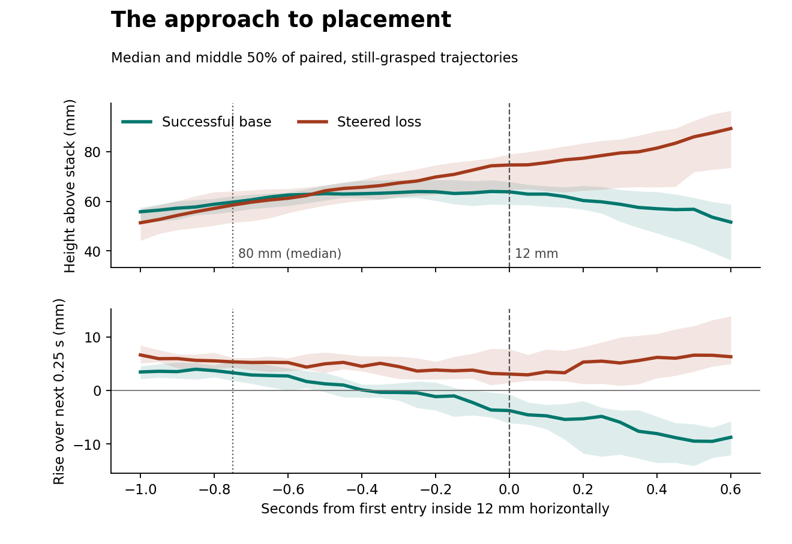

# Switching off noise steering on approach to the stack

In two archived cohorts, the steered cube was still climbing as its successful base partner leveled off or descended, typically around **31–32 mm from the target**. We switched steering off at **80 mm** to return control before that point. On 100 fresh matched Isaac scenes, the earlier handoff stacked **48 times**, the 12 mm handoff **45 times**, and the frozen base **53 times**. Earlier handoff improved descent and opening counts, with a small and uncertain gain in completed stacks.

| Policy | Stable stacks | Reached 12 mm while lifted | Rising at alignment | Descent started by 0.6 s after alignment | Never opened after lift |
| --- | ---: | ---: | ---: | ---: | ---: |
| Frozen base | 53/100 | 94 | 20/94 | 71/94 | 28 |
| 12 mm handoff | 45/100 | 96 | 31/96 | 67/96 | 40 |
| 80 mm handoff | 48/100 | 97 | 23/97 | 75/97 | 34 |

The 80 mm handoff kept 44 of the 45 later-handoff successes, added four stacks, and lost one (+3 percentage points, two-sided exact McNemar p = 0.375). Against the frozen base it gained ten scenes and lost 15 (−5 points, p = 0.424). The 12 mm handoff gained nine and lost 17 against the base (−8 points, p = 0.169). These paired tests are unadjusted. Five discordant scenes between the handoffs leave substantial uncertainty about a repeatable difference in stacking. [Per-scene outcomes](paired-outcomes.csv) · [Paired comparisons and successful seeds gained or lost](approach-summary.json)

All 100 early switches fired after the initial lift. Among the 97 early-handoff runs that reached 12 mm, the median time from switching to alignment was 16 ticks (0.80 s). Of the 40 scenes on which the later handoff never opened, the early handoff opened on six and stacked on two.

## When the climb starts

We compared the original 16 scenes where the frozen base stacked and always-on direct steering never opened after lifting. Both policies started sustained cube ascent during pickup, roughly three seconds before reaching the target. Relative to each rollout's first entry inside 12 mm, median ascent onset was 2.93 s earlier for the successful base and 2.78 s earlier for the steered failures. Their first upward commands appeared at similar times. The difference emerged as the base leveled off and started its descent.

| Measurement in those 16 pairs | Successful base | Always-on steering |
| --- | ---: | ---: |
| Median height above stack height at first entry inside 80 mm | 59.1 mm | 59.5 mm |
| Median cube rise over the next 0.25 s at 40 mm | +0.1 mm | +4.5 mm |
| Median cube rise over the next 0.25 s at 12 mm | −3.8 mm | +3.1 mm |
| Sustained descent started by 0.60 s after alignment | 16/16 | 2/16 |

We also measured the first matched quarter-second window where the steered cube rose while its successful base partner was level or descending. This occurred in 15/16 pairs. The window began a median **0.30 s before alignment**, when the steered cube was **32.4 mm** horizontally from blue. In a separate archived cohort of 14 base-success/direct-never-open pairs, it occurred in 13/14, a median **0.35 s before alignment at 31.1 mm**. These cohorts were selected for their outcomes. [Per-pair timing](climb-separation.csv) · [All archived loss events, including runs that opened](climb-events.csv)

The missed descent concentrated in the failures that never opened. In the eight other original losses, seven steered runs and all eight base runs had started sustained descent by 0.60 s after alignment. On the original 36 scenes where both policies stacked, all 36 in each arm had started descending by then. In the replication cohort, 26/27 steered successes and 27/27 paired base successes met that timing. [Successful-pair timing](successful-pair-timing.csv)



Time zero is each rollout's own first alignment. Bands show the interquartile range. At each time, both runs in a pair must still be carrying the cube for the complete five-tick window. [Time-aligned trajectories](aligned-profiles.csv) · [Distance-aligned measurements](approach-distances.csv)

### Timing definitions

Initial ascent is measured during the continuous grasp leading to alignment. A sustained climb begins at the first five-tick window with at least 2.5 mm of net cube rise and four positive increments. Descent uses the same test with the sign reversed, beginning the search at the first entry inside 80 mm. Command onset uses four of five commands in the corresponding direction and a mean requested vertical displacement of at least 1 mm per tick. Windows end before the first opening command or grasp loss. Onset times label window starts and use subsequent recorded observations.

For opposite vertical motion, we compared trajectories at the same offset from each rollout's own first alignment. Both had to have entered 80 mm. We searched window starts from 1.25 s before alignment through 0.60 s after. The direct run had to meet the sustained climb definition and the base cube had to have zero or negative net height change. Reported times and distances are medians among pairs with an observed event. [Detection counts and replication measurements](climb-summary.json)

## Fresh Isaac comparison

We locked a single 80 mm radius using the original 16 archived pairs. At that distance the two groups were at nearly equal median heights, about 15 control ticks from alignment. We evaluated the same frozen imitation policy, direct-reward actor and varied-data RSSM on 100 new scene seeds (508–607). The arms were unsteered imitation, the existing 12 mm handoff and the new 80 mm handoff. Both handoffs permanently remove the actor's noise shift on the first tick the red cube is grasped, lifted more than 20 mm above its initial height and inside the specified horizontal radius. The same observation, Gaussian draw and chunk timing supply the base action for a mid-chunk switch. The base checkpoint had stacked on 15/32 development scenes.

The three policies shared scene seeds, initial geometry and Gaussian noise streams. Arm order rotated by seed. Seed 508 was recorded with cameras. The primary outcome was Isaac's eight-tick stable stack after release. Every arm completed one rollout per seed with the same frozen weights. Each executed command was reconstructed from its observation history in a separate audit.

All recorded initial coordinates matched exactly within scene. The largest normalized-action discrepancy in command replay was 0.000006. In 90 pairs, the two handoff arms reached the 80 mm boundary on the same tick with the same grasp and gripper-command histories, and their tracked positions stayed within 2 mm through that observation. All four gains and the one loss between handoffs occurred among these closely matched pairs. [Pre-switch trajectory checks](paired-prefixes.csv)

## Reproduction

```bash
original=runs/isaac-midbase-v5
previous=runs/isaac-target-handoff-v6
run=runs/isaac-approach-handoff-v7
mkdir -p "$run"
cp "$original/selected-base.pt" "$original/mid-varied-direct.pt" "$run/"
python scripts/climb_timing.py "$run" --original "$original" --previous "$previous"
python scripts/plot_climb.py "$run"
python scripts/target_handoff.py "$run" --approach-study --prior "$original" --first 508 --count 1 --video
for first in 509 542 575; do
  python scripts/target_handoff.py "$run" --approach-study --prior "$original" --first "$first" --count 33
done
python scripts/summarize_approach.py "$run" --original "$original" --previous "$previous"
```
