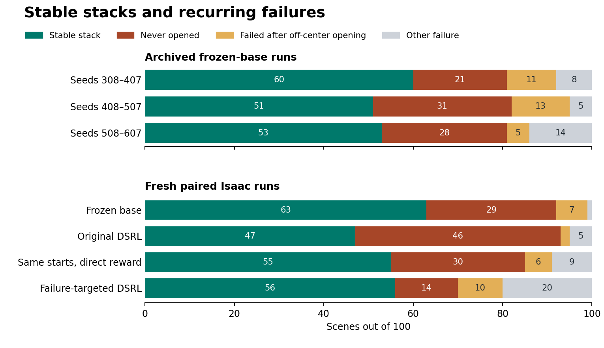

# DSRL trained to avoid recurring stacking failures

The new noise-steering actor learned to lower the cube on approach. On 100 fresh Isaac scenes, high holds without an opening command fell from **26 to 5** compared with a DSRL actor trained from identical starts with the previous reward. Stable stacks went from **55 to 56**. The frozen imitation policy stacked **63 times**. The targeted actor more often placed the cube within tolerance and then failed to move its gripper clear for the required eight ticks.

## Fresh Isaac results

Each controller ran once on every seed from 608 through 707. Scene and Gaussian action-noise seeds were paired, and controller order rotated by scene. All 400 runs lifted the cube. Each count in the table is out of 100 scenes. The high-hold column is a subset of runs that never opened.

| Controller | Stable stacks | Never opened after lift | Held high while centered and never opened | Failed after first opening off-center | Opened centered, ended in pose without a stack |
| --- | ---: | ---: | ---: | ---: | ---: |
| Frozen base | 63 | 29 | 27 | 7 | 1 |
| Original direct-reward DSRL | 47 | 46 | 44 | 2 | 5 |
| Matched starts, direct reward | 55 | 30 | 26 | 6 | 8 |
| Matched starts, failure-targeted reward | 56 | 14 | 5 | 10 | 19 |



Against the matched direct-reward actor, the targeted actor gained 23 stacks and lost 22 on paired scenes (+1 percentage point, two-sided exact McNemar p = 1.00). Against the frozen base, it gained 14 and lost 21 (−7 points, p = 0.311). Against the original DSRL actor, it gained 26 and lost 17 (+9 points, p = 0.222). Changing the starting-state distribution with the previous reward already raised stacks from 47 to 55 (12 gained, 4 lost, p = 0.077). The differences are from one training seed, with unadjusted paired tests. [All paired outcomes](paired-outcomes.csv) · [Seed lists and failure-mode transitions](failure-dsrl-summary.json)

**Descent transferred to Isaac.** At first horizontal alignment, 2 of 94 targeted runs were still climbing, compared with 22 of 97 matched-control runs. From elevated near-target states, the observed mean six-tick height change was −10.6 mm for targeted steering and +3.1 mm for the matched control. The targeted actor visited the release-ready band on 87 scenes, versus 61 for the matched control. Within recorded six-tick windows starting in that band, it issued an open command in 23.2% of windows versus 40.7%. These on-policy windows overlap and the actors visit different states. The common-state model check below provides a separate comparison.

**Retreat after release limited completion.** Nineteen targeted runs first opened centered, ended inside the cube pose tolerances and timed out at 200 ticks. In 15 of those 19, the cube was in pose with the jaws physically open for at least eight consecutive ticks. Only three of the 19 ever met the pose, opening and 50 mm tool-clearance requirements simultaneously after opening. None maintained them for eight ticks. Median tool-to-cube distance at timeout was 12.8 mm. Off-center opening also persisted, with 11 of 86 targeted first openings off-center versus 6 of 70 in the matched control. Ten and six of those runs failed, respectively. The aggregate stack count therefore hides both recovered high holds and newly lost placements. [Per-episode opening, dwell and clearance measurements](paired-outcomes.csv)

The clearance check uses post-command observations, measured finger aperture above 35 mm, tool distance above 50 mm, horizontal error below 12 mm, height error below 8 mm and the simulator's blue-cube height band. The recorded traces omit instantaneous cube velocity. The reported dwell is an upper bound on the full stable-stack dwell, which also requires slow cubes. Every scored success passed the geometric eight-tick check. Replaying all 400 action sequences from observations, policy weights and the paired Gaussian noise reproduced every control to within 0.0000045 in normalized action units. Initial recorded coordinates matched exactly across controllers, and the seed audit confirmed no overlap with training, development or earlier tests.

## Finding the recurring failures

We applied a common event detector to 900 archived trajectories across three disjoint 100-scene cohorts and three policies per cohort. The 300 unsteered trajectories used the same frozen imitation checkpoint. They provide the reference for designing the intervention. The remaining trajectories show whether the same patterns recur under the prior steering policies. Counts below use each base scene once. [Per-cohort census](archived-failure-modes.json) · [Individual archived events](archived-failure-events.csv)

| Frozen-base cohort | Stacks | Failures | Never opened after lift | Never opened and stayed high while centered | Failed after first opening off-center |
| --- | ---: | ---: | ---: | ---: | ---: |
| Seeds 308–407 | 60 | 40 | 21 | 16 | 11 |
| Seeds 408–507 | 51 | 49 | 31 | 25 | 13 |
| Seeds 508–607 | 53 | 47 | 28 | 24 | 5 |
| Total | 164 | 136 | 80 | 65 | 29 |

All 300 base runs lifted the cube. Of 136 failures, 80 never commanded opening after lift. Of those 80, 65 reached horizontal tolerance holding the cube and stayed more than 8 mm above the intended stack height every time they were centered and lifted. An upstream sign was sustained climbing at first alignment, seen in 54 failures and one success. The earlier timing analysis found the climb continuing as the successful base began descending approximately 31–32 mm from the target. [Paired timing measurements](../isaac-approach-handoff-v7/README.md)

Of the 56 failures that opened, 29 first commanded opening while grasped at least 12 mm off-center, compared with two of 164 successes. Opening high was common among successful runs. Of the 164 stacks, 95 first commanded opening more than 8 mm above final stack height. Across the first cohort's 60 stacks, the 90th percentile opening height was 20.4 mm above the final height. We therefore allowed a broad release-height range in the reward. The remaining 27 failures first opened centered. Ten ended outside the pose tolerances and 17 ended inside them without completing the stable-stack criterion.

## Learning a noise shift

We reused the 72-demonstration imitation policy that stacked on 15 of 32 development scenes at 2,000 updates. The varied-data RSSM had been trained on the original 24 demonstrations and 72 mixed-outcome rollouts. Both checkpoints stayed frozen. [Base selection and world-model history](../isaac-midbase-v5/README.md)

Both new DSRL actors used the existing noise-space SAC implementation. At each three-tick chunk the actor outputs a bounded four-dimensional shift (±0.5) applied to Gaussian noise for the frozen flow policy. The policy supplies the actual Cartesian and gripper commands. The actor runs throughout the episode, and all four evaluation arms use the normal policy entry point.

Both new actors trained on the same starting-state tensor containing 3,764 filtered demonstration states, 1,882 approach states and 1,882 placement states. For the two additional groups, we filtered recorded histories from the 100 original unsteered runs on seeds 308–407. We sampled chunk boundaries with a grasp, closed command and lift greater than 20 mm. The horizontal bands were 20–80 mm and below 20 mm. The pools contained 690 and 1,260 eligible boundaries, respectively, sampled with replacement using seed 17. Real actions filtered the RSSM up to the starting state. All actor-training transitions, rewards and continuations came from imagination. The base, varied-data RSSM, actor initialization, optimizer, six-tick horizon, 1,500 updates and 576,000 imagined ticks were matched. [Training provenance and checkpoint hashes](training.json)

The **matched direct** actor received the previous direct state reward. The **targeted** actor also received four terms computed from consecutive RSSM-decoded states, with distances expressed in millimeters.

1. **Descent.** While the cube remains held and the gripper closed, reward reduction in excess height above a clearance that tapers from 68 mm at 60 mm horizontal distance to 8 mm at 12 mm. Both heights are compared with the previous tick's clearance. The term scales by proximity (zero at 80 mm, full weight at 40 mm) and by 0.5 per 5 mm of progress, clipped to ±0.5 per tick.
2. **Centering.** In the same carrying region, reward reduction in horizontal error beyond an 8 mm margin. The weight is 0.3 per 5 mm, clipped to ±0.3 and scaled by the same proximity.
3. **Centered release.** Add 0.45 times the change in a potential for an open command and aligned cube. The potential is maximal within 8 mm horizontally and from −8 to +25 mm vertically, tapering to zero at 18 mm horizontally and at −16 or +40 mm vertically. Reclosing removes the open-state credit.
4. **Off-center opening.** On a held, closed-to-open transition, subtract up to 0.5 for horizontal error beyond 12 mm, reaching the full penalty at 22 mm.

The original dense task potential, one-time verified stable-stack bonus, and learned continuation discount remain part of both rewards. At evaluation, Isaac's original eight-tick stable-stack condition determines success. [Reward implementation](../../minidaydreamer/placement_reward.py)

## Model check before judging Isaac outcomes

We replayed the four actors from identical filtered histories in the separate seeds 408–507 base trajectories, holding the Gaussian inputs and stochastic RSSM innovations fixed. At 1,144 elevated, near-target chunk boundaries, the targeted actor reduced mean predicted six-tick height gain from +2.92 mm with matched direct reward to +0.26 mm. At 260 centered, release-ready boundaries, its predicted six-tick opening frequency fell from 36.9% to 18.1%. These measurements test what the noise shift learned inside the model. [Independent common-noise probe](model-probe.json)

## Reproduction

```bash
prior=runs/isaac-midbase-v5
archived=runs/isaac-horizon-24ticks-v3
confirmation=runs/isaac-target-handoff-v6
approach=runs/isaac-approach-handoff-v7
run=runs/isaac-failure-dsrl-v8
mkdir -p "$run"
cp "$prior/selected-base.pt" "$prior/mid-varied-direct.pt" "$run/"
python scripts/stack_failure_modes.py "$run" "$prior" "$confirmation" "$approach"
python scripts/failure_dsrl.py train "$run" --prior "$prior" --archived "$archived"
python scripts/probe_failure_steering.py "$run" --confirmation "$confirmation"
python scripts/failure_dsrl.py score "$run" --first 608 --count 1 --video
for first in 609 634 659; do
  python scripts/failure_dsrl.py score "$run" --first "$first" --count 25
done
python scripts/failure_dsrl.py score "$run" --first 684 --count 24
python scripts/summarize_failure_dsrl.py "$run" --prior "$prior" --archived "$archived"
python scripts/plot_failure_dsrl.py "$run"
```
