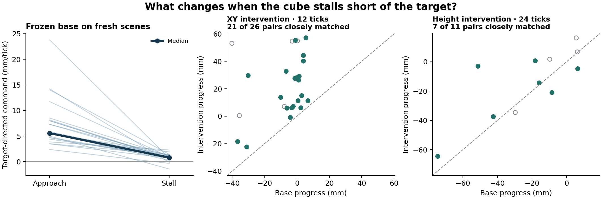

# Imagination horizon and carry stalls in Isaac

Increasing noise-space RL imagination from 6 to 24 control ticks produced no increase in stable stacks on 50 new scenes. The varied-data actor went from four stacks to three. Both demos-only actors had zero. The frozen base stacked twice.

| Policy | Stable stacks | Lifted | Reached horizontal tolerance while lifted | Detected stalls | Successful scene seeds |
| --- | ---: | ---: | ---: | ---: | --- |
| Frozen base | 2/50 | 50 | 17 | 25 | 208, 239 |
| Demos RSSM, 6 ticks | 0/50 | 50 | 21 | 36 | — |
| Demos RSSM, 24 ticks | 0/50 | 50 | 22 | 38 | — |
| Varied RSSM, 6 ticks | 4/50 | 50 | 16 | 29 | 215, 239, 254, 257 |
| Varied RSSM, 24 ticks | 3/50 | 50 | 16 | 30 | 208, 239, 254 |
| Base with brief XY intervention | 2/50 | 50 | 33 | 26 | 208, 239 |

The 24-tick varied actor gained one scene and lost two against its six-tick counterpart (−2 percentage points, two-sided exact McNemar p = 1.00). Both succeeded on seeds 239 and 254. With one training seed and few completed stacks, these results establish no reliable horizon advantage. [Per-scene outcomes](paired-outcomes.csv) · [Paired comparisons and intervention summaries](horizon-summary.json)

## Why the cube stalls

The frozen base stalled on 25/50 fresh scenes, a median 40.1 mm from the target. All 25 failed to stack. In 24 cases we could compare the stall with an earlier productive segment of the same carry. The median target-directed command fell from **5.58 to 0.80 mm per tick**, while the sideways component during the stall was 3.42 mm per tick. Measured target-directed wrist and cube movement both fell from 1.29 to 0.14 mm per tick. Their horizontal motion differed by only 0.011 mm per tick during these stalls. The arm was asking for little motion toward the target while still carrying the cube. The earlier 50-scene test showed the same pattern, and none of the 24 scripted training demos met the stall criterion. [Fresh events](transport-events.csv) · [Archived-scene diagnosis](prior-transport-summary.json)

**Changing only the XY command restored local progress.** The control activated on 26/50 fresh scenes. In all 21 closely matched pairs, the intervention reduced the cube's distance to the target more than the unmodified base over the next 12 ticks. The median paired gain was **23.9 mm**. The number of trials that reached horizontal tolerance while lifted rose from 17 to 33, and those that reached the full position tolerance rose from 7 to 14. The two policies completed exactly the same two stacks. The intervention improved transport, while stable placement and release remained difficult. [Individual intervention windows](transport-summary.json)

**Carry height affects the frozen policy's choice of direction.** On the fresh base stall states, substituting expert carry heights (median adjustment +42.7 mm) increased mean target-directed commands by a median paired 5.95 mm per tick. Moving both the cube and wrist height inputs upward by just 10 mm increased the command by 0.95 mm per tick. In comparison, switching from six- to 24-tick noise steering at the same observed histories changed target-directed commands by a median −0.29 mm per tick for demos-only and −0.08 for varied data. The synthetic input probes measure the policy's sensitivity to pose. The experimental height manipulation below tests whether that sensitivity translates into motion. [Fresh frozen-policy probes](transport-probes.json) · [Archived probes](prior-transport-probes.json)

On 12 separately replayed archived scenes, 11 vertical interventions activated and seven pairs met the strict prefix match. The intervention raised the cube by a median 33.1 mm. Subsequent target-directed commands increased in six of seven matched pairs (median paired change +1.74 mm per tick). Horizontal progress improved in five of seven (+5.2 mm median paired difference). Median signed progress over 24 ticks was still negative for both arms, and neither arm stacked on any of the 12 scenes. Low carry height contributes to some stalls. The evidence for insufficient horizontal command is stronger. [Paired height trials](height-check.json)



Each line at left is a fresh base-policy scene. In the intervention panels, each point is a scene with a complete comparison window. Filled points met the pre-intervention trajectory match. Points above the diagonal made more horizontal progress with the intervention.

## Experiment

### World-model accuracy at the longer horizon

We replayed recorded actions from 633 identical windows on 12 independent diagnostic scenes (seeds 1201–1212). Forecasts used the mean latent transition and were initialized from the full observation history. The table gives mean 3D red-cube error and the mean discounted sum of raw predicted rewards. The corresponding observed mean discounted return was 0.014 at six ticks and 0.049 at 24 ticks.

| Forecast horizon | Stationary cube | Demos-only cube error | Varied cube error | Demos-only mean predicted return | Varied mean predicted return |
| --- | ---: | ---: | ---: | ---: | ---: |
| 6 ticks | 10.1 mm | 4.9 mm | 2.8 mm | 1.239 | 0.037 |
| 24 ticks | 36.6 mm | 19.4 mm | 11.1 mm | 6.701 | 0.173 |

Both models still beat persistence over 24 ticks. The demos-only reward head substantially overestimated return. Across the same windows, the varied model's predicted-to-measured return correlation fell from 0.58 to 0.24. Longer imagination exposed the actor to these errors. Their individual effect on stacking was not isolated. [Independent forecast and reward measurements](horizon-forecast.json)

### Training and fresh evaluation

A conditional flow policy trained on 24 successful stacking demonstrations remained frozen. For each repaired RSSM (24 demos alone, or the same demos plus 72 varied rollouts), we reproduced the original base, world-model and six-tick actor weights exactly. We restored the pre-actor random state and trained the 24-tick actor from the same initialization. The world model, reward, discount, noise scale, replay capacity, SAC minibatch and 1,500 updates were the same. Training used one seed and no Isaac transitions for RL.

Each SAC update generated 128 three-tick transitions. The six-tick condition drew 64 demonstration-history starts and rolled each for two chunks. The 24-tick condition drew 16 starts and rolled each for eight chunks. Both generated 192,000 chunk transitions. The critic bootstrapped at each chunk boundary in both conditions. The longer horizon changes how far imagined states develop from a recorded history and how many independent histories contribute per update.

We scored the base, four learned actors and a separate base-policy XY intervention on the same 50 new scene seeds, 208–257. Each policy received the same per-scene Gaussian noise stream, the execution order rotated and starting positions had to agree within 1 mm. Only seed 208 used cameras. The simulator counted a stack after release, gripper clearance and eight stable ticks. The policies used state observations at 20 Hz. In the machine-readable records, `original_demos` and `original_varied` denote the repaired six-tick actors, while `demos` and `varied` denote their 24-tick counterparts.

## How stalls and interventions were measured

A carry had to stay grasped with the gripper commanded closed and the red cube more than 20 mm above its initial height. After at least 15 mm of horizontal approach in that continuous carry, a stall was the first 12-tick window with at most 2 mm of net progress, entirely outside the 12 mm horizontal tolerance. This includes pauses and reversals. For each eligible episode we compared the stall with its most recent nonoverlapping 12-tick window in the same carry with at least 6 mm of progress. Command values are projected Cartesian target displacements. Wrist and cube values are measured displacements in Isaac.

- **XY intervention.** On fresh scenes, a separate base-policy arm supplied target-directed XY commands for up to 12 ticks from the first detected stall. It retained the policy's vertical and gripper commands and stopped on opening, grasp loss or reaching horizontal tolerance.
- **Height intervention.** We chose the lowest 12 previously tested seed IDs whose archived base stalled by tick 164. Each got two new Isaac trials using the base policy, with order alternating. For up to 12 ticks the intervention changed only the vertical command to aim 35 mm above the cube's height at detection. No horizontal or gripper command was overwritten. We measured the actual rise, horizontal progress over 24 ticks and subsequent target-directed commands. We recorded whether the stall reproduced on replay.
- **Pair quality.** For the local intervention comparisons, the strict subset required the two trajectories to agree through the trigger to within 2 mm for every tracked position and to have identical grasp and gripper-command histories. All complete windows are also reported. Physics history can change a replay even when the starting seed matches.
- **Frozen-policy probes.** We replayed the actual observation at the policy's three-tick chunk boundary and used 512 common Gaussian draws per state. We changed height, wrist-to-cube offset or target location while preserving the other inputs. Expert geometry was the median of five horizontally nearest examples from distinct demos, each actively commanding transport. These input probes test the policy's response to a state change. The separate Isaac interventions test actual motion.

## Reproducing the run

Use the same Isaac environment and the previous experiment's frozen artifacts. The following commands run the four evaluation shards serially. The reported run used separate Isaac processes in parallel.

```bash
old=runs/isaac-residual-24-v2
run=runs/isaac-horizon-24ticks-v3
mkdir -p "$run"
cp "$old/base.pt" "$old/corpus.npz" "$run/"
for arm in demos varied; do
  python -m minidaydreamer train --data "$run/corpus.npz" --base-model "$run/base.pt" \
    --world-model residual --coverage "$arm" --seed 0 --model-steps 1800 --rl-steps 1500 \
    --imagination-chunks 8 --match-short "$old/$arm.pt" --out "$run/$arm.pt"
done
python scripts/diagnose_transport.py "$old" --output "$run/prior"
python scripts/probe_transport.py "$old" --analysis "$run/prior" --short "$old" --long "$run"
python scripts/check_horizon.py "$run" --diagnostic-data "$old/forecast-check.npz"
python scripts/test_carry_height.py --base "$run/base.pt" --events "$run/prior/transport-events.csv" --out "$run/height"
for spec in 100:1 101:17 118:16 134:16; do
  offset=${spec%:*}
  count=${spec#*:}
  camera=()
  if [[ $offset == 100 ]]; then camera=(--video-dir "$run/videos"); fi
  python -m minidaydreamer compare --demos-model "$run/demos.pt" --varied-model "$run/varied.pt" \
    --original-models "$old/demos.pt" "$old/varied.pt" --test-transport-pulse \
    --scene-offset "$offset" --episodes "$count" --trace-dir "$run/traces" \
    --out "$run/eval-$offset.jsonl" "${camera[@]}"
done
python scripts/summarize_horizon.py "$run" --prior "$old"
python scripts/plot_transport.py "$run"
```
