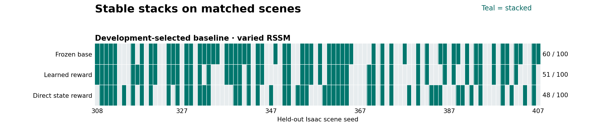

# Noise-space steering with a development-selected stacking baseline

The frozen policy stacked on **15/32 development scenes**. On 100 fresh Isaac scenes it completed **60 stable stacks without steering, 51 with learned-reward steering, and 48 with direct-state-reward steering**. A moderately competent baseline left 40 failures available to rescue. Both noise actors lost more successful scenes than they rescued in this run.

| Policy | Lifted | Reached horizontal tolerance while lifted | Stable stacks | Gained / lost vs. base | Paired exact p vs. base |
| --- | ---: | ---: | ---: | ---: | ---: |
| Frozen imitation policy | 100 | 98 | 60/100 | — | — |
| Learned-reward steering | 100 | 98 | 51/100 | 2 / 11 | 0.0225 |
| Direct-state-reward steering | 100 | 97 | 48/100 | 12 / 24 | 0.0652 |

The direct actor changed 36 outcomes relative to the base, compared with 13 for the learned-reward actor. Comparing direct reward with learned reward, direct gained 14 scenes and lost 17 (−3 percentage points, exact p = 0.720). The p-values are unadjusted. The direct-vs.-learned comparison gives little evidence that either reward produces a better actor here. [Paired outcomes by scene](paired-outcomes.csv) · [Audit and exact comparisons](midbase-summary.json)



### What changed during stacking

In every one of the 24 scenes where direct steering lost a base success, it still lifted the cube and brought it within 12 mm of the target horizontally. Reaching that tolerance at some point leaves vertical alignment, placement, release and settling to complete. The experiment did not isolate which of these steps caused each loss. On recorded scene 308 the unsteered and learned-reward policies stacked, and the direct actor failed.

On 3,072 six-tick windows from unsteered held-out trajectories, direct reward predicted discounted return with mean absolute error **0.0066**, compared with **0.0969** for learned reward. The direct rule matched all 60 terminal windows in those forecasts. On the measured trajectories of all three arms, it matched Isaac's 159 stacks at the exact completion tick with zero false positives. These accuracy checks use recorded actions. They do not establish how reliably the predicted reward ranks alternative noise choices during actor training. [Forecast and event checks](midbase-summary.json)

Replaying identical measured states and noise draws from base trajectories, the direct actor changed the first gripper decision on three of 2,973 carrying chunk starts. The learned actor changed it on one. At the 2,044 carrying chunk starts outside horizontal tolerance, the mean change to the target-directed command was −0.31 mm for direct steering and +0.14 mm for learned steering. These are differences in the requested displacement. A rollout can change its eventual release timing after earlier motion changes. [Same-state action replay](midbase-summary.json)

## Selecting the base

We reused the 72 successful scripted demonstrations, geometry features, horizontal data augmentation, flow policy architecture, optimizer and training seed from the previous experiment. The only change to imitation was the number of updates. The final 12,000-update training checkpoint reproduced the previous 72-demo model's weights exactly.

We defined “about half” as 14–18 stable stacks on 32 development seeds (5300–5331). Starting at 1,000 updates, we evaluated each candidate without steering on all 32 scenes. The search moved earlier or later in training according to the development score and refined brackets between low- and high-scoring checkpoints. We accepted the first in-band checkpoint. A byte-for-byte copy served as the frozen base for all three arms. The selection record preserves all attempted candidates and their individual scene outcomes. [Development results](selection.json)

The 1,000-update checkpoint stacked on 8/32 development scenes. The 2,000-update checkpoint stacked on **15/32 (46.9%)** and qualified. Both actor checkpoints record the SHA-256 digest of the selected base, `eafd9895ee92b67c3a8c922fe9cb213e786a16553d3fbd1b84bbfa1aaeb16ef9`.

## Training and evaluation

The varied-data residual RSSM had already been trained on the original 24 demonstrations and 72 mixed-outcome rollouts. Both noise actors started from the same actor-training RNG state and trained with 1,500 SAC updates. Each saw 576,000 imagined control ticks. Imagination started from the same pool of original demonstration histories and ran for six ticks at a time. Both arms used the same learned continuation model. One received the learned reward head's output. The other received the change in predicted task potential and a once-only bonus for stable release computed from consecutive predicted states. No Isaac transitions from the fresh test entered training or selection. [Reward definition and validation](../isaac-state-reward-v4/README.md)

All three arms faced 100 new Isaac scene seeds (308–407) at 20 Hz. Each used the same per-seed Gaussian noise stream, with arm order rotating by scene. Seed 308 was recorded with cameras. Success required gripper release and clearance and eight stable ticks with red stacked on blue. The audit verified every trace, initial state, frozen policy tensor, frozen world-model tensor and the two actors' training budgets. Paired gains and losses count scenes on which exactly one arm stacked. Two-sided exact McNemar tests use the discordant pairs. The comparisons share one training seed.

## Reproduction

Use the repository's Isaac environment with the previous experiment artifacts in `runs/`. The original evaluation used three concurrent headless shards and a separate camera process.

```bash
short=runs/isaac-residual-24-v2
archived=runs/isaac-horizon-24ticks-v3
prior=runs/isaac-state-reward-v4
run=runs/isaac-midbase-v5
mkdir -p "$run"
cp "$prior/base.pt" "$prior/corpus.npz" "$prior/extra-bc.npz" "$run/"
python scripts/select_midbase.py fit "$run"
python scripts/select_midbase.py select "$run"
python scripts/reward_study.py actors "$run" --group mid --short "$short" --rng "$archived"
python scripts/reward_study.py score "$run" --group mid --first 308 --count 1 --video
for first in 309 342 375; do
  python scripts/reward_study.py score "$run" --group mid --first "$first" --count 33
done
python scripts/summarize_midbase.py "$run" --prior "$prior" --short "$short" --archived "$archived"
python scripts/plot_state_reward.py "$run"
```
