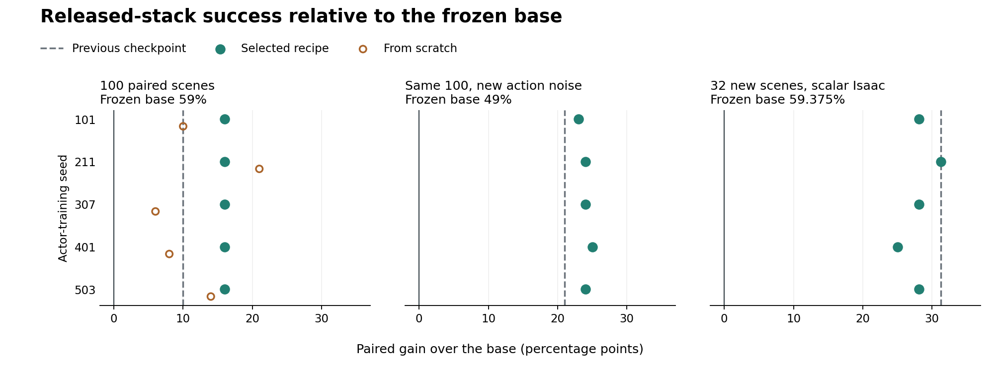

# Multi-seed DSRL for released, stable stacks

**The tuned steering recipe averaged 74% released stacks against 54% for the frozen base across two action-noise streams on 100 held-out scenes.** The gain was **20.0 percentage points**, with a 95% crossed-bootstrap interval of **+10.7 to +29.2**. It averaged 4.5 points above the previous steering checkpoint on the same comparisons (interval −1.9 to +10.7). The data support an advantage over the unsteered base. The improvement over the previous steering actor and the difference from the earlier 18-point estimate are less certain.

| Evaluation | Frozen base | Previous steering | Selected recipe, five-seed mean | Paired gain over base (95% interval) |
| --- | ---: | ---: | ---: | ---: |
| Primary 100 scenes | 59.0% | 69.0% | 75.0% | +16.0 points (+5.0 to +27.0) |
| Same 100 scenes, second action-noise stream | 49.0% | 70.0% | 73.0% | +24.0 points (+11.0 to +36.8) |
| 32 additional single-environment scenes | 59.4% | 90.6% | 87.5% | +28.1 points (+9.4 to +46.9) |

The second noise stream yielded 72, 73, 73, 74 and 73 successes in ascending training-seed order. The separate single-environment cohort yielded 28, 29, 28, 27 and 28 out of 32, versus 19 for the base and 29 for the previous actor. All five selected actors beat the base in all three comparisons. The previous actor led the selected recipe's mean on the 32-scene cohort. The two 100-scene rows share the same physical scenes, and the uncertainty calculation preserves that pairing.



## Primary held-out result

On 100 fresh scenes, **all five locked actors stacked 75 times**, the frozen imitation base stacked **59 times**, and the previous steering actor stacked **69 times**. Every selected actor rescued 26 base failures and lost 10 base successes. The paired gain was **16 percentage points** (95% crossed-bootstrap interval +5 to +27). Against the previous actor each gained 12 and lost six, a six-point estimate with an interval of −2 to +14. The earlier 18-point observation came from a different cohort and stopping rule. [Per-scene outcomes](paired-outcomes.csv) · [Validation statistics and checkpoint hashes](multiseed-summary.json)

The five selected actors agreed on the outcome of every primary scene despite distinct training initializations. On 1,340 chunk boundaries from the first 20 unsteered test histories, their applied four-dimensional noise shifts had a mean between-seed standard deviation of 0.0020 per coordinate. Their mean absolute change from the previous actor was 0.115 per coordinate. The previous actor with just the 1.25 multiplier stacked 67 times. The selected actors gave similar behavior with their shared prior and independently learned corrections.

The five unanchored actors scored **69, 80, 65, 67 and 73** using seeds 101, 211, 307, 401 and 503, respectively. Their mean was 70.8%, or 11.8 points above the base (95% interval −0.4 to +23.6). The 80-stack actor was one of the controls carried into confirmation. The locked policy-selection rule used only the development scenes.

## Success criterion

The red cube must be released and stable throughout the last eight control ticks (0.4 seconds). At every tick the gripper is commanded open with measured aperture above 35 mm, the red cube is within 12 mm horizontally and 8 mm vertically of the stack pose, the blue cube remains at table height, and both cubes have instantaneous linear speed below 25 mm/s. The hand can finish any distance from the cube. All policies continue until tick 200 or a physical drop. In the previous study episodes could stop early once the hand cleared the stack. The two studies therefore differ in both scenes and stopping rule. [Previous 81/100 result](../isaac-retreat-v9/README.md)

## What was optimized

The 72-demonstration imitation policy, varied-data RSSM and previous retreat actor stayed frozen. The new actor learns a bounded four-dimensional shift to the Gaussian noise driving the frozen imitation policy. It trained entirely in imagination, starting from the same demonstration and historical carrying states as the previous actor. The steering learner ran for 1,500 SAC updates with 576,000 imagined control ticks per training seed. Four three-command chunks give each imagined rollout 12 ticks to reach and maintain a released stack.

The reward retains the previous approach, centering and opening terms. It adds 0.25 for each predicted released, slow, aligned tick, 0.1 times the change in dwell count and a once-only two-point bonus for eight consecutive qualifying ticks. The RSSM approximates cube speed by one-tick displacement and uses its grasp estimate plus the issued open command. At evaluation Isaac supplies measured finger aperture and instantaneous cube speeds. Imagination uses a fixed 0.99 per-tick discount. Neither the new reward nor evaluation requires a tool-distance threshold. [Released-state reward and noise controller](../../minidaydreamer/released_steering.py)

On 32 development scenes, the frozen base stacked 19 times and the previous actor stacked 25. We compared three training recipes using seeds 11 and 29. Steering learned from scratch produced 22 and 21 stacks. Retaining half of the frozen previous actor's shift produced 22 and 23. Retaining 80% produced 25 and 24. Critics trained on the applied mixture at each imagined step. We selected the recipe by mean success across development training seeds, breaking ties by the weaker seed.

We then tested four inference strengths for the selected recipe on those same development scenes. Multipliers of 0.75, 1.00, 1.25 and 1.50 produced 25/23, 25/24, 28/27 and 25/24 stacks across the two seeds. We locked **1.25** before confirmation. At deployment this makes the shift exactly the previous actor's shift plus one quarter of the new actor's shift. Its maximum magnitude is 0.625 per dimension. The imitation policy still generates every robot command. [Recipe selection](selection.json) · [Strength selection](gain-selection.json)

## Validation design

Five new actor-training seeds (101, 211, 307, 401 and 503) independently randomized the new actor, critics, imagination draws and replay sampling. The selected recipe shares the frozen previous steering checkpoint. We also evaluated five actors trained from scratch under the new reward with no shared steering weights at native inference strength. The first three scratch controls were in the initial protocol. We added the other two before test scoring to cover all five seeds. An additional control applies the selected 1.25 multiplier to the previous actor alone. [Protocol](protocol.json) · [Evaluation plan](evaluation-plan.json) · [Development strength and control plan](gain-plan.json)

The primary test uses 100 new physical scenes (840–939). A standard single-environment Isaac reset supplied the complete relative robot and object state for each seed. Parallel copies restored these states before each policy, preserving scene identity and lane assignment. Every policy received the same sequence of Gaussian draws on each scene. A second evaluation changed only the Gaussian seed to the scene seed plus 1,000,003. A separate cohort of 32 new scenes (940–971) ran the frozen base, previous actor and all five selected-recipe actors through the original single-environment policy entry point. The same released-at-finish stopping rule applied in both evaluators. [Noise replication plan](noise-plan.json) · [Physical evaluator](../../scripts/score_multiseed.py)

Uncertainty intervals use 20,000 crossed bootstrap draws, resampling training seeds and physical scenes independently and retaining the paired base outcome whenever a scene is drawn. The two-stream analysis averages within each physical scene before resampling. Five actor seeds share one base, world model and, for the selected recipe, the earlier steering checkpoint. The intervals describe variability conditional on these checkpoints.

The audit checked all 2,672 development, tuning and validation trajectories. Each ran for 200 control ticks. Initial positions matched across the paired policies, every released-stack outcome was recomputed from positions, aperture and instantaneous speeds, and all executed actions were reconstructed to within 0.0000027 in normalized units. [Audit implementation](../../scripts/summarize_multiseed.py)

## Reproduction

With the previous run directories available and the Isaac environment active, the following commands reproduce the selection and validation. Independent scorer invocations can run concurrently.

```bash
run=runs/isaac-multiseed-v10
previous=runs/isaac-retreat-v9
midbase=runs/isaac-midbase-v5
mkdir -p "$run"/{dev,gain,test,noise,scalar,prior_gain}
cp "$previous/retreat.pt" "$run/previous.pt"
cp "$previous/selected-base.pt" "$run/"
python scripts/multiseed_study.py prepare "$run" --old "$previous" --midbase "$midbase"
for recipe in solo prior50 prior80; do
  for seed in 11 29; do
    python scripts/multiseed_study.py train "$run" --midbase "$midbase" --recipe "$recipe" --seed "$seed"
  done
done
python scripts/score_multiseed.py bank "$run" dev
for split in dev gain; do
  for first in 808 824; do
    python scripts/score_multiseed.py batch "$run" "$split" --first "$first" --count 16 --width 16
  done
  if [ "$split" = dev ]; then
    python scripts/multiseed_study.py select "$run"
  else
    python scripts/multiseed_study.py gain "$run"
  fi
done
winner=$(python -c 'import json,sys;print(json.load(open(sys.argv[1]))["winner"])' "$run/selection.json")
for recipe in $(printf '%s\n' "$winner" solo | uniq); do
  for seed in 101 211 307 401 503; do
    python scripts/multiseed_study.py train "$run" --midbase "$midbase" --recipe "$recipe" --seed "$seed"
  done
done
python scripts/score_multiseed.py bank "$run" test
for split in test noise; do
  python scripts/score_multiseed.py batch "$run" "$split" --first 840 --count 60 --width 20
  python scripts/score_multiseed.py batch "$run" "$split" --first 900 --count 40 --width 20
done
python scripts/score_multiseed.py batch "$run" prior_gain --first 840 --count 100 --width 20
for first in 940 948 956 964; do
  python scripts/score_multiseed.py scalar "$run" scalar --first "$first" --count 8
done
python scripts/summarize_multiseed.py "$run" "$midbase"
python scripts/plot_multiseed.py "$run"
```
