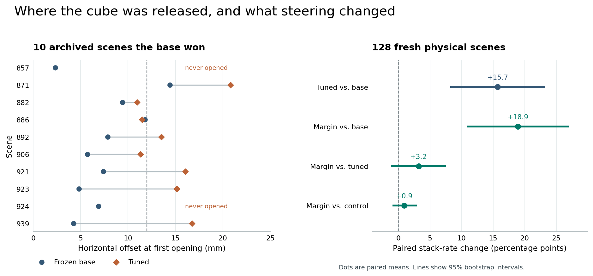

# Can a release-margin reward improve cube stacking?

**Noise-space steering raised stacking from 59.8% to 78.7% on 128 fresh Isaac scenes. The new release-margin reward added an estimated 0.9 percentage points over an otherwise identical actor trained with the old reward (95% interval −0.9 to +2.9).** All five new steering actors beat the frozen imitation policy. The extra reward's contribution remains uncertain, and the off-center failures it targeted persisted.

| Controller | First noise stream | Second noise stream | Two-stream mean |
| --- | ---: | ---: | ---: |
| Frozen imitation policy | 60.9% | 58.6% | 59.8% |
| Earlier retreat actor | 75.0% | 75.8% | 75.4% |
| Previously tuned steering | 70.9% | 80.0% | 75.5% |
| Local correction with the old reward | 76.7% | 78.8% | 77.7% |
| Local correction with the release-margin reward | 77.2% | 80.2% | **78.7%** |

The new actor gained **18.9 percentage points** against the frozen base (95% paired interval **+10.9 to +27.0**). The previous tuned actor independently retained a **15.7-point** gain on these same scenes (+8.2 to +23.3). Its earlier estimate was +20.0 points on a different 100-scene cohort. The release-margin actor's additional gain over that tuned actor was **+3.2 points** (−1.2 to +7.5). That difference was +6.3 on the first action-noise stream and +0.2 on the second. [Prior study](../isaac-multiseed-v10/README.md) · [All paired estimates and intervals](margin-summary.json)



## Which failures changed

Off-center first openings followed by a failed stack occurred **12.7 times per 100** runs with the tuned incumbent, **16.8** with the matched old-reward correction and **15.9** with the margin reward. The estimated change for margin versus incumbent was +3.3 per 100 (95% interval −0.1 to +6.8). The change versus matched control was −0.9 (−2.7 to +0.9). The new actors continued to miss laterally.

A more consistent change was **releasing the cube at all**. Failures that lifted and never opened fell from 5.7 per 100 with the incumbent to 2.0 with the margin actor, a change of −3.7 (−6.0 to −1.6). The matched control reached 1.6 per 100. These are post-training trajectory observations. The matched control also changed release behavior, which limits how much of the gain we can attribute to the new reward. [Per-scene opening measurements and outcomes](paired-outcomes.csv)

| Incumbent seed / new training seed | Base stacks | Tuned stacks | Old-reward correction | Margin stacks | Margin gain over base |
| --- | ---: | ---: | ---: | ---: | ---: |
| 101 / 1201 | 153 | 189 | 198 | 197 | +17.2 pp |
| 211 / 1213 | 153 | 194 | 195 | 199 | +18.0 pp |
| 307 / 1237 | 153 | 194 | 205 | 207 | +21.1 pp |
| 401 / 1259 | 153 | 195 | 199 | 201 | +18.8 pp |
| 503 / 1277 | 153 | 194 | 198 | 203 | +19.5 pp |

Each row covers 128 physical scenes × two noise streams, or 256 trials per policy. The same 153 base stacks appear in every row. Across 4,352 evaluation episodes, the audit reproduced every terminal score and every logged action. Paired initial positions agreed in both streams. The separately filmed single-environment replays of scene 972 reproduced the base miss and the steered stack and are excluded from all estimates.

## What went wrong on the old scenes

The five tuned actors failed on the same 25 of the previous 100 primary scenes. I counted each physical scene once, using the first validation actor (seed 101) for the detailed comparison. That actor first opened off-center in **13** failures. It never opened in **8** (five never centered while lifted and three stayed high while centered). The remaining **4** opened within tolerance and finished outside the stack pose. The off-center count was 13–14 across the five actors. [All 25 matched trajectories, measured at opening and finish](archived-failure-pairs.csv) · [Failure counts by actor](archived-failures.json)

The frozen base stacked in ten of these scenes. Five tuned losses first opened at least 12 mm from center. Three first opened 11.0–11.5 mm from center and finished 13.2–14.1 mm out, at acceptable height. Two never opened. In the eight pairs where both opened, the median offset was 7.6 mm for the base and 14.3 mm for the tuned actor. The tuned actor opened farther out in seven pairs, by a median paired difference of 6.0 mm. It opened earlier in two, later in four and at the same tick in two.

Height and alignment overlapped. Of the incumbent's 17 archived failures with an opening, 15 first opened at least 8 mm above the stack pose, 13 opened off-center and 12 did both. Of its 75 successes, 32 also opened at least 8 mm high, while **zero** opened at least 12 mm off-center. The 12 mm cutoff applies to the settled cube. At first opening, the same distance provides a diagnostic for this controller. [Opening geometry by outcome](archived-opening-geometry.json)

## Teaching a release margin in imagination

The frozen flow policy learned three-command chunks from 72 successful scripted demonstrations. The base checkpoint stacked on 15/32 development scenes. The residual RSSM had learned cube motion from 24 demonstrations and 72 varied rollouts. It works with simulator state, including cube and gripper poses. During steering training it predicts the consequences of candidate noise shifts. At evaluation the flow policy converts shifted Gaussian noise into robot commands and the RSSM filters the new observation. [Base selection](../isaac-midbase-v5/README.md) · [Model repair](../isaac-residual-24-v2/README.md)

Each of the five incumbent actors kept its previously selected steering weights and 1.25 deployment multiplier. I added a learned correction to its four noise coordinates during the final approach. The correction fades in when the gripper holds a cube close to the target, and can move a noise coordinate by at most 0.375. The signed displacement of red from the desired stack pose is available to the correction actor. Its critic trains on the total applied noise shift.

The new reward credits lateral progress toward 6 mm of center while the cube is held. On a closed-to-open transition, credit changes sign at 9 mm of horizontal error, using the larger error just before and after opening. Positive opening credit also depends on proximity to the right height. The physical success criterion stays at 12 mm. A matched control uses the previous released-stack reward with exactly the same controller, start distribution, optimizer, training seed and budget. [Reward and controller](../../minidaydreamer/release_margin.py)

Each actor trained for 1,500 SAC updates with 12-tick imagination rollouts and 576,000 model-generated ticks. Half the start pool reused 7,528 histories from the previous study. The other half sampled with replacement from 885 suitable chunk boundaries on the **previous** 100 primary scenes, including successes and failures. These histories initialize the model. Every transition used for RL was generated in the frozen RSSM. The imitation policy, world model, earlier steering prior and paired incumbent were checked against their checkpoints after training. [Locked protocol](protocol.json) · [Training code](../../scripts/margin_study.py)

As an offline diagnostic, I replayed measured action sequences into the frozen world model from before the first opening on 92 archived scenes. Twelve ticks out, the model predicted horizontal offset with 1.36 mm mean absolute error, versus 3.71 mm if red and blue stayed still. Within 4 mm of the new reward boundary it predicted the correct side on 42/53 openings. These forecasts use the commands that actually occurred. Ranking untried noise shifts during policy improvement is a separate test. [Forecast measurements](release-forecasts.json) · [Individual forecasts](archived-release-forecasts.csv)

## What counted as a stack

Every contender ran on 128 fresh Isaac scene seeds, 972–1099. Both streams restored the same saved robot and object poses. The policies shared all underlying Gaussian draws within each scene and stream. The second stream added 1,000,003 to the Gaussian seed. Each run continued for 200 control ticks or until a physical drop. For the final eight ticks (0.4 seconds), the gripper had to be commanded open with measured aperture above 35 mm, horizontal error below 12 mm, vertical error below 8 mm, both cube speeds below 25 mm/s and blue at table height. The hand could finish at any distance. [Physical scoring code](../../scripts/score_multiseed.py) · [Fresh-scene runner](../../scripts/score_margin.py)

The primary estimates first average the two streams within each physical scene. Each of 20,000 bootstrap draws resamples scene IDs and actor seed pairs independently and retains all matched policy outcomes within those draws. The 128 scenes are the independent physical units. The five steering pairs share one base, world model and earlier steering prior. The intervals describe those checkpoints on this simulated task. [Uncertainty and replay audit](../../scripts/audit_margin.py)

MiniDayDreamer combines the idea of practicing in a learned world model with the idea of steering a frozen generative policy through its input noise. Here the generative policy is a flow policy driving a simulated Franka arm. [DayDreamer](https://danijar.com/project/daydreamer/) · [Diffusion Steering via Reinforcement Learning](https://diffusion-steering.github.io/)

## Reproducing the experiment

The commands use the frozen checkpoints and trajectory directories from the [previous multi-seed experiment](../isaac-multiseed-v10/README.md). Run from the project root in the Isaac environment. The audit checks the frozen checkpoints, every saved endpoint and every executed command. The scene bank captures one standard single-environment Isaac reset for each physical seed before restoring it to parallel lanes.

```bash
run=runs/isaac-release-margin-v11
old=runs/isaac-multiseed-v10
midbase=runs/isaac-midbase-v5
mkdir -p "$run"/{test,noise}/traces
python scripts/audit_margin.py archive "$run" "$old"
python scripts/margin_study.py prepare "$run" "$old" "$midbase"
python scripts/probe_margin.py "$run" "$old"
for recipe in control margin; do
  for seed in 101 211 307 401 503; do
    python scripts/margin_study.py train "$run" "$old" "$midbase" --recipe "$recipe" --seed "$seed"
  done
done
python scripts/score_margin.py bank "$run" "$old"
for stream in test noise; do
  python scripts/score_margin.py score "$run" "$old" --split "$stream" --width 32
done
python scripts/audit_margin.py audit "$run" "$old"
python scripts/plot_margin.py "$run"
python scripts/film_margin.py "$run" "$old" --arm prior80-101
```
