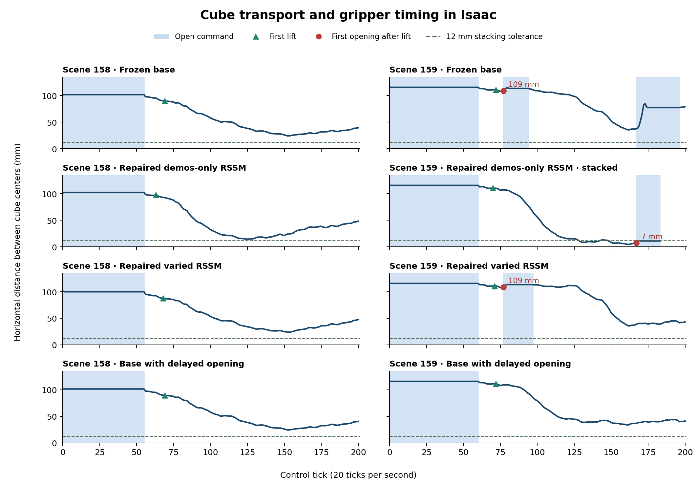

# RSSM cube forecasts and gripper timing in Isaac

Both repaired world models beat a stationary cube forecast on independent scenes. Their noise-steering actors each stacked twice on 50 fresh Isaac scenes. The base policy and each original actor stacked once. Early opening accounted for many base failures, and delaying release alone produced no additional stacks.

## Stable stacks on 50 paired scenes

| Policy | Lifted | Stacked | Successful seeds | Median final horizontal separation |
| --- | ---: | ---: | --- | ---: |
| Frozen base | 49/50 | 1/50 | 169 | 52.6 mm |
| Original demos-only RSSM | 50/50 | 1/50 | 201 | 75.0 mm |
| Original varied RSSM | 48/50 | 1/50 | 169 | 63.4 mm |
| Repaired demos-only RSSM | 50/50 | 2/50 | 159, 160 | 64.7 mm |
| Repaired varied RSSM | 50/50 | 2/50 | 196, 200 | 50.9 mm |
| Base with delayed opening | 49/50 | 1/50 | 169 | 34.2 mm |

Each repaired actor gained two scenes and lost the base's one success. Each also gained two and lost one against its corresponding original actor. The net difference was +2 percentage points in each comparison (two-sided exact McNemar p = 1.00). The repaired actors succeeded on disjoint scenes. The small number of stacks and single training seed leave the policy improvement uncertain. [All 300 paired outcomes](paired-outcomes.csv) · [Scores and paired tests](summary.json)

## Did the policy open too early?

Among **49 base-policy failures**, the first opening after lift was horizontally off-center in 25 trials, and one more opened within the horizontal tolerance but outside the height tolerance. Another 19 never commanded an opening after lift. Three first opened inside the stacking zone and still failed, and one did not lift. Among the 29 failed trials that opened after lifting, median horizontal separation at opening was 52.3 mm. In the 24 successful training demos it was 1.3 mm. All 29 failed trials lost Isaac's grasp signal within three control ticks of opening. [Per-trial events](release-events.csv) · [Event counts](release-summary.json)

The delayed-opening control suppressed at least one command in 27/50 scenes. It improved median final horizontal separation from 52.6 to 34.2 mm, yet its success outcome matched the base on every scene. It finished 44 trials with the grasp signal still active. Transport and alignment remained limiting. The gate used the final stack geometry as a release rule. Some policies successfully dropped a horizontally centered cube from higher up.

To check the role of noise, we replayed the base's original gripper proposal at each of its 27 first openings outside the zone, including one eventual success. We then resampled its Gaussian input 512 times at the same observed chunk-start state and scored the same action within that chunk. The median fraction requesting opening was 3.1%. Only one of 27 states produced a majority of open proposals. These states were selected because an opening actually occurred. This fraction describes those specific decisions. [Noise-resampling measurements](gripper-noise.json)

The first two test scenes show the distinction. On seed 158 the base never opened after lifting and stayed at least 24 mm off-center. On seed 159 it opened 109 mm off-center at tick 77. The repaired demos-only actor carried the red cube until tick 167, opened 7.4 mm off-center and 23.0 mm above its final stacked height, and completed the stack. The delayed-opening control on that scene held on but came no closer than 33.8 mm while grasped.



## Why the original RSSM lost position

The original RSSM reconstructed absolute cube positions through its latent state and learned on eight-transition snippets. Evaluation filtered the entire episode before each forecast. In a separate set of 12 scenes (705 six-step windows), its estimate of the red cube was already wrong at the instant of the latest measurement. The mean starting errors were 51.8 mm for demos-only and 33.1 mm for varied rollouts. Two checks on the same checkpoints exposed different sources of error.

| Six-step 3D cube error on independent scenes | Demos only | Varied rollouts |
| --- | ---: | ---: |
| Original model, full history | 63.1 mm | 42.8 mm |
| Original model, most recent eight transitions | 32.1 mm | 18.7 mm |
| Add only the original model's predicted displacement to the measured start | 21.1 mm | 16.8 mm |
| Repaired RSSM, full history | **4.7 mm** | **2.7 mm** |
| Predict the cube stays still | 9.1 mm | 9.1 mm |

The shorter history reduced error while keeping weights and actions fixed. Anchoring only the original model's predicted displacement also helped, but its motion estimates still fell short of persistence. The repair carries the measured positions and latest displacement in the recurrent state, learns changes in position, and trains on six-step open-loop predictions as well as single steps. It predicts grasp state and propagates the commanded gripper setting from the action. The stochastic latent, learned dynamics, reward and success heads remain part of imagination.

On independent windows where the cube moved at least 5 mm, the repaired models' errors were 6.5 mm and 4.8 mm, compared with 25.9 mm for a stationary cube. On the original development set (707 windows), their overall errors were 4.4 mm and 2.7 mm, compared with 9.9 mm for persistence. The architecture and loss were changed together. [Forecasts, split identifiers and context-length checks](forecast-audit.json)

## Experimental design

- The same 24 successful demonstrations and original 12,000-update imitation checkpoint were used throughout. The varied condition added the same 72 scripted rollouts. Each repaired RSSM trained for 1,800 updates. Each steering actor trained for 1,500 soft actor-critic updates, entirely on six-step imagined transitions starting from the same demo histories. All training used seed 0.
- The noise actors receive their respective world model's state. The repaired actors can read the carried pose and displacement explicitly. Comparisons with the original actors measure the combined effect of this representation and the new dynamics training.
- Confirmation data contained paired scripted trajectories from seeds 1201–1212, disjoint from world-model development, fitting, policy calibration, and both policy test blocks. No confirmation trajectories were used to train a policy or RSSM.
- The 50 new Isaac policy scenes used seeds 158–207. All six arms received matched Gaussian noise and matched starting observations. Policy order rotated. The first scene recorded cameras for all six arms. The other 49 used the state-only version of the same task. The simulator logged every issued action, cube and tool position, grasp signal, and finger aperture.
- The delayed-opening control used the frozen base. Once the cube had lifted and the grasp signal was active with the gripper commanded closed, the control overrode open requests outside the stack tolerance (horizontal separation under 12 mm and height within 8 mm of the stacked center). Cartesian commands came from the same frozen policy. Later decisions could change because the state changed. This privileged control was scored separately from the learned arms.
- A completed stack still required release, gripper clearance, low motion and eight consecutive stable ticks. Isaac's grasp signal uses gripper aperture and tool proximity. It indicates a likely grasp, while the independent cube-height measurement establishes a lift.

## Reproduction

With the Isaac environment active, start with the original run's `corpus.npz`, `base.pt`, `demos.pt` and `varied.pt`. The commands below use the original experiment as `old` and a fresh output directory as `run`.

```bash
old=runs/isaac-full-24-v1
run=runs/isaac-residual-24-v2
mkdir -p "$run"
cp "$old/corpus.npz" "$old/base.pt" "$run/"
for arm in demos varied; do
  python -m minidaydreamer train --world-model residual --coverage "$arm" --data "$run/corpus.npz" \
    --base-model "$run/base.pt" --model-steps 1800 --rl-steps 1500 --seed 0 --out "$run/$arm.pt"
done
python -m minidaydreamer collect --seed 1200 --demos 1 --extra 0 --holdout 12 --out "$run/forecast-check.npz"
python scripts/check_cube_forecasts.py "$run" --original "$old" --first-test 158 --scenes 50
for spec in 50:1 51:17 68:16 84:16; do
  offset=${spec%:*}
  count=${spec#*:}
  camera=()
  if [[ $offset == 50 ]]; then camera=(--video-dir "$run/videos"); fi
  python -m minidaydreamer compare --scene-offset "$offset" --episodes "$count" \
    --demos-model "$run/demos.pt" --varied-model "$run/varied.pt" \
    --original-models "$old/demos.pt" "$old/varied.pt" --test-release-gate \
    --trace-dir "$run/traces" --out "$run/eval-$offset.jsonl" "${camera[@]}"
done
python scripts/summarize_stack.py "$run" --episodes 50 --scene-offset 50
python scripts/diagnose_stack.py "$run"
python scripts/gripper_noise.py "$run"
python scripts/plot_release.py "$run" --seeds 158 159
```
