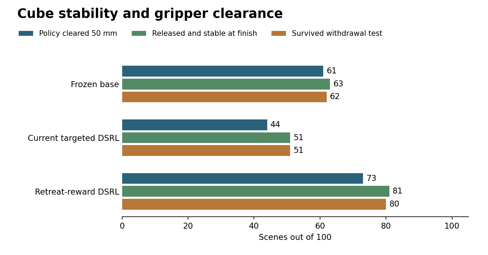
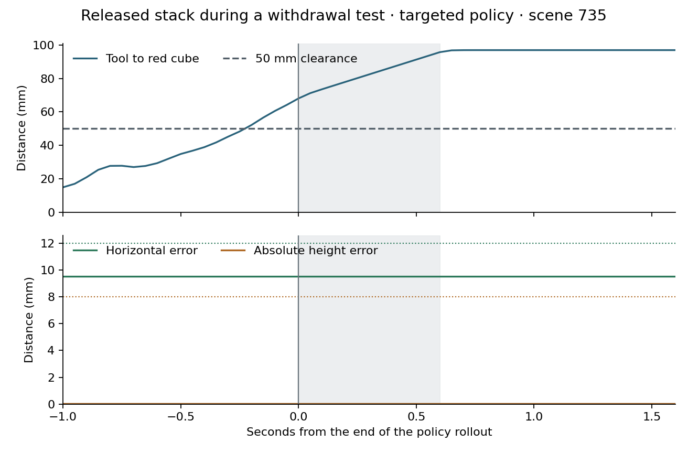

# Does a released stack need 50 mm of gripper clearance?

**For the object-stacking task, score a released, slow stack at the end of the rollout. Report whether the policy also moved the gripper 50 mm clear as a second outcome.** On 100 fresh matched Isaac scenes, DSRL with a retreat reward produced **81 terminal stacks**, compared with **51** for the previous targeted actor and **63** for the frozen base. The new actor also led on the original clearance criterion.

| Policy | Released, stable at finish | Policy also cleared 50 mm for eight ticks | Passed the fixed withdrawal test |
| --- | ---: | ---: | ---: |
| Frozen base | 63 | 61 | 62 |
| Current targeted DSRL | 51 | 44 | 51 |
| Retreat-reward DSRL | **81** | **73** | **80** |

The retreat actor gained 27 terminal stacks and lost 9 on the same scenes as the frozen base (+18 percentage points, exact paired p = 0.00393). Against the current targeted actor it gained 34 and lost 4 (+30 points, p < 0.000001). Under the stricter clearance criterion it gained 22 and lost 10 against the base (+12 points, p = 0.0501) and gained 34 and lost 5 against the targeted actor (+29 points, p = 0.00000243). It autonomously cleared all seven scenes where the targeted actor had a terminal stack without strict success. It also cleared 26 scenes where that actor never achieved an eight-tick released stack. Changing the steering reward affected the entire trajectory. These comparisons use one training initialization, one rollout per policy per scene, and unadjusted two-sided exact McNemar tests. [Paired results by scene](paired-outcomes.csv) · [Outcome transitions, seed lists and exact tests](retreat-summary.json)



**The clearance rule excluded 17 stable terminal placements across the 300 rollouts.** Every one had open jaws and no detected grasp throughout the last eight ticks. Nine had no tick satisfying all the strict conditions together. Eight reached them for one to seven consecutive ticks. All 17 retained the cube pose throughout a separate withdrawal. Fifteen passed its full one-second clearance check immediately. On the two remaining scenes the fixed withdrawal stopped short. Replays of the recorded commands reproduced both terminal stacks and both passed after withdrawal to a measured 70 mm. The second probe is a follow-up on those two cases. The table gives the original fixed-probe counts. For the targeted actor, one more scene met the relaxed eight-tick condition transiently and lost it before timeout. [Measured-distance checks](adaptive-summary.json)

The first fresh targeted scene by seed with a confirmed placement excluded by the clearance rule was 735. The cube stayed in position while the hand crossed 50 mm late, accumulating five qualifying ticks before timeout. In the plot, time zero is the end of policy control, shading covers the separate withdrawal command, and dotted lines show the cube pose tolerances.



## What happened on the 19 disputed placements?

We replayed the exact actions from the previous targeted actor's 19 failures that first opened centered and ended in pose. The original traces preserved positions and finger aperture. Using position differences to estimate speeds, 15 appeared released and stable at some point and 12 at timeout. The new replays recorded instantaneous PhysX speeds. Thirteen met the eight-tick released-stack rule at some point, **11 met it at timeout**, and all 11 had no detected grasp throughout the final eight ticks. None met the original clearance rule during policy control. The median of the 19 maximum tool-or-cube trajectory deviations from the original was 1.05 mm, with a maximum of 4.02 mm. Nine replays stayed within 1 mm in both positions and aperture with identical grasp flags. [Per-scene archived measurements and replay differences](archived-outcomes.csv)

All 11 terminal stacks stayed in pose during a separate withdrawal. Eight passed the fixed one-second clearance test. For the other three, both cubes stayed slow throughout the final second while the tool stopped 38–46 mm from the cube. We replayed those same controls and withdrew until the measured clearance exceeded 70 mm, allowing up to 80 ticks. Those placements took 24, 27 and 27 upward ticks. All three stayed in pose and passed the subsequent one-second open, clear and ungrasped check. The same follow-up rule covers every fresh or archived fixed withdrawal that retained pose and fell short on clearance. Follow-up replay outcomes are reported separately from the original policy and fixed-test scores. [Measured-clearance follow-up](adaptive-summary.json)

## What each outcome measures

All three frozen policies ran once on each of 100 fresh Isaac scenes, seeds 708–807. The scene and Gaussian action noise were paired and controller order rotated. Each policy ran until its original strict success, a drop or the 200-tick limit. The alternate scoring rules used observations from the same rollout and had no effect on its termination.

| Outcome | Measurement |
| --- | --- |
| Policy cleared 50 mm | Isaac's original success. For eight consecutive 50 ms ticks, the open-commanded gripper has measured aperture above 35 mm and its tool point is more than 50 mm from the red cube. Red stays within 12 mm horizontally and 8 mm vertically of its target on blue. Blue remains in its table-height band and each cube's instantaneous linear speed is below 25 mm/s. |
| Released and stable at finish | The same eight-tick test ending at the last policy tick, with the tool-distance requirement removed. We also count whether a policy reached this condition at any time during its rollout. |
| Survived withdrawal test | Starting from a terminal released stack, issue open-gripper vertical withdrawal commands for up to 12 ticks toward a point 100 mm above the cube, then hold position with the fingers open for 20 ticks (one second). The cube pair must remain within pose tolerances throughout all 32 ticks. For the final second the tool must be more than 50 mm clear, the fingers open, both cubes slow, and the simulator grasp flag false on every tick. |

The withdrawal is a standardized intervention applied after the scored policy episode. It tests whether a placement persists when the hand moves away. Its motions earn no policy credit for clearing the gripper. The probe-success rate uses all 100 scenes per arm as its denominator, and we also report survival specifically among the additional placements admitted by the relaxed rule. [Evaluator](../../scripts/score_retreat.py) · [Physics and pairing audit](../../scripts/summarize_retreat.py)

The audit verified zero difference in the recorded initial coordinates across the three controllers, reproduced every normalized action to within 0.0000037, recomputed both scores from the raw physics traces, and checked that seeds 708–807 were disjoint from training, development and earlier test scenes.

## Training the retreat reward

The unsteered imitation policy and current targeted DSRL actor are the exact checkpoints from the previous experiment. The new actor used the same frozen base and varied-data RSSM as the targeted actor. We trained from the same actor initialization, demonstration and historical approach-state tensor, optimizer and 1,500 SAC updates. Each six-tick imagined rollout had two three-command chunks. Only the new actor's reward changed. All 576,000 actor-training ticks came from the RSSM. [Previous targeted actor](../isaac-failure-dsrl-v8/README.md) · [Training hashes and counters](training.json)

On top of the existing targeted reward, the actor earns signed progress in tool-to-cube clearance up to 50 mm, worth +1 for a full 50 mm withdrawal. Both predicted states must have the gripper open, the cube released and in pose. Each cube must move less than 1.25 mm over the tick. A second term adds 0.1 for each additional qualifying open, slow, in-pose, clear tick. Breaking an incomplete streak returns its accumulated credit. The original two-point completion bonus still fires once at eight ticks. The actor saw 25,613 outward-progress ticks, 1,652 inward-progress ticks, 13,247 dwell advances and 1,856 completions in imagination. These counts describe training transitions sampled from histories with different amounts of prior dwell. [Reward implementation](../../minidaydreamer/placement_reward.py)

## Reproduction

```bash
run=runs/isaac-retreat-v9
previous=runs/isaac-failure-dsrl-v8
midbase=runs/isaac-midbase-v5
horizon=runs/isaac-horizon-24ticks-v3
mkdir -p "$run"
cp "$previous/selected-base.pt" "$previous/targeted.pt" "$run/"
python scripts/train_retreat.py "$run" "$previous" "$midbase" "$horizon"
python scripts/score_retreat.py "$run" --first 708 --count 1 --video
for first in 709 734 759; do
  python scripts/score_retreat.py "$run" --first "$first" --count 25
done
python scripts/score_retreat.py "$run" --first 784 --count 24
python scripts/score_retreat.py "$run" --archived "$previous"
python scripts/score_retreat.py "$run" --archived "$previous" --video
python scripts/summarize_retreat.py "$run" "$previous" "$midbase"
python scripts/plot_retreat.py "$run"
python scripts/verify_short_withdrawals.py "$run" "$run/adaptive"
```
