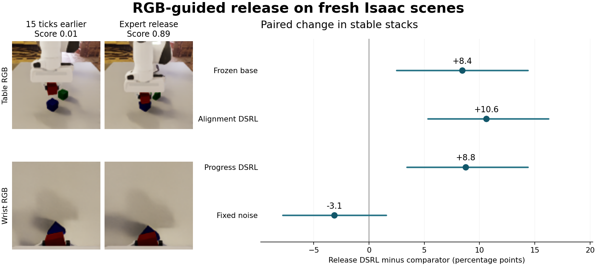

# Visual release steering for the frozen RGB stacking policy

**Release DSRL stacked 127/320 times, versus 100/320 for the frozen RGB base.** The gain was **8.44 percentage points**, or 27% relative (paired 95% scene-bootstrap interval +2.50 to +14.38 points). Against the previous alignment-targeted actor the gain was 10.63 points. The highest observed success rate came from a fixed gripper-noise shift using the same visual release detector, **137/320**. Its gain over the base was **11.56 points** (95% scene interval +5.94 to +17.19). The experiment supports visual release steering. The learned actor showed no clear advantage over the fixed shift.

| Controller | Stable stacks | Success | Reached position, never opened | Opened off-center and failed |
| --- | ---: | ---: | ---: | ---: |
| Frozen RGB flow | 100/320 | 31.3% | 31 | 31 |
| Previous alignment DSRL | 93/320 | 29.1% | 36 | 36 |
| Previous progress DSRL | 99/320 | 30.9% | 31 | 32 |
| Release DSRL | 127/320 | 39.7% | 1 | 51 |
| Same visual trigger, fixed gripper-noise shift | 137/320 | 42.8% | 0 | 58 |



The photos show the first reserved expert demonstration, fifteen ticks before first opening and at opening. Each line on the right is a paired 95% scene-bootstrap interval for release DSRL minus the named comparator. [Numerical results](summary.json)

## Where the gain came from

Of the **31** fresh trials where the unsteered base reached both tolerances and never opened, release DSRL **stacked 16**. Eight opened off-center, two opened centered but high, two opened within the bands then failed, two never lifted, and one never centered. The single held-in-position failure under release DSRL occurred on a different trial. Overall, release DSRL gained 50 base failures and lost 23 base successes, a net 27 stacks. The fixed shift gained 55 and lost 18. These are matched scene/noise outcomes, and individual episodes include simulator replay variability. [Matched transitions and timing](mechanism.json)

**The physical height audit matters for interpreting “ready.”** The learned actor applied a nonzero noise shift on 179 trials. All 179 still registered a grasp at the first shift. Of those, 131 were horizontally centered and only five were within both physical placement tolerances. Median horizontal error was 8.7 mm and median height was 25.8 mm above the desired stack position. On the 156 trials that issued an open command within six ticks, median height at opening was still **23.9 mm high** and only 12 opened within both bands. This cue often induced a short drop. Off-center opening failures rose from 31 to 51, even as held-in-position failures fell from 31 to one. The rate of stable stacks increased despite that tradeoff. [Physical intervention audit](mechanism.json)

| Release DSRL minus comparator | Difference | 95% paired scene interval | 95% lighting-group and seed interval |
| --- | ---: | ---: | ---: |
| Frozen base | +8.44 points | +2.50 to +14.38 | −3.05 to +18.71 |
| Previous alignment DSRL | +10.63 points | +5.31 to +16.25 | 0.00 to +20.25 |
| Previous progress DSRL | +8.75 points | +3.44 to +14.38 | −0.63 to +18.32 |
| Same trigger, fixed noise | −3.13 points | −7.81 to +1.56 | −10.38 to +3.80 |

The fixed-shift control was selected as a pretest benchmark because −14 opened all sampled commands in the historical noise-response check. The learned actor was optimized on imagined trajectories. Its improvement over the base was positive on four of five seed-assigned scene subsets. Resampling lighting groups and actor seeds yields a wider interval crossing zero. For fixed noise versus base, the gain was positive on all five scene subsets, and the corresponding interval was +2.42 to +20.68 points. This benchmark isolates the value of a learned state-dependent shift only up to the two controllers’ different proposal magnitudes.

| Seed assigned to scenes | Frozen base | Alignment DSRL | Progress DSRL | Release DSRL | Fixed noise |
| --- | ---: | ---: | ---: | ---: | ---: |
| 101 | 23/64 | 21/64 | 21/64 | 27/64 | 28/64 |
| 211 | 20/64 | 18/64 | 17/64 | 17/64 | 23/64 |
| 307 | 22/64 | 17/64 | 23/64 | 31/64 | 33/64 |
| 401 | 14/64 | 17/64 | 14/64 | 26/64 | 25/64 |
| 503 | 21/64 | 20/64 | 24/64 | 26/64 | 28/64 |

The two unsteered passes on the first Gaussian stream both stacked on 47/160 and agreed on 142 individual outcomes. Across the two streams, the base stacked 47 and 53 times, release DSRL stacked 64 and 63 times, and fixed noise stacked 74 and 63 times. Independently re-scoring all 320 development and 1,760 held-out rollouts from commands, jaw aperture, cube position and speed reproduced every reported stack. We also reproduced the trigger timings from saved RGB scores and command history and checked that the starting camera embeddings matched across arms.

## Why change the noise range?

The 23 diagnostic replays reached both placement tolerances while grasped but never commanded the gripper open. They span 17 physical scenes. In 21 replays, the cube stayed in position for at least eight consecutive ticks. The median longest stay was 27 ticks. We used this group to choose the failure to address. The physical trajectories were diagnostic evidence only. [All 23 replay records](diagnostic-23.csv) · [Earlier diagnosis](../isaac-rgb-target-v13/README.md)

The previous study preserved camera features for another 31 unsteered, held-in-position failures. We took the first seated observation from each and sampled 15 matched Gaussian chunks through the frozen flow. At zero gripper-noise shift, 0.22% of generated gripper commands opened. At −0.5, the limit of the earlier actors in this coordinate, 0.36% opened. At −10, 83.5% opened, and at −14 all opened. Larger shifts also moved the other flow outputs. At −14 the mean absolute change per XYZ command component was 0.126 on the normalized [−1, 1] action scale. These measurements are frozen-flow counterfactuals. [Noise-response measurements](diagnostic.json)

## How release works

The detector locates red and blue pixels in each 96 × 96 table and wrist RGB image by color saturation. The relative cube centers across both views form four image coordinates. Successful expert open commands anchor the expected appearance of a red cube at release. We fit the center and regularized covariance from five frames around first release in each of the existing 72 successful demonstrations. The score measures similarity to that appearance. On the four reserved successful validation demonstrations, the score was 0.89–0.94 at release and 0.006–0.064 fifteen ticks earlier. It depends on the known cube colors and camera arrangement. [Visual model](../../scripts/rgb_release_geometry.py) · [Validation](geometry.json)

The visual RSSM predicts the frozen encoder’s features. A small network learned to estimate the two-view geometry score from those features using the 72 demonstrations and 72 varied RGB recordings. On 16 validation episodes it had 0.031 mean absolute error and 0.922 correlation with the image score on observed features. In imagination, the reward favors issuing an open command at high readiness, keeping both cubes in alignment after the action, and limiting motion while releasing. It penalizes opening at low readiness. SAC trained five actors for 1,500 updates and 576,000 imagined action ticks apiece, including extra posterior starts near closed-gripper release opportunities. The flow, camera encoder, RSSM and progress model stayed frozen. Simulator poses, contact flags and physical successes were kept out of network training. The scripted expert and selection of successful demonstrations predate this experiment. [Release actor and reward](../../scripts/rgb_release_actor.py)

At rollout, the two live images supply the readiness score. After 12 consecutive closed commands and the selected visual trigger, the actor can shift the gripper coordinate of the Gaussian flow input by up to −18. XYZ noise stays unchanged. To limit movement induced through the coupled flow, the controller tries 65%, 82%, then 100% of the proposed shift and takes the first chunk that opens throughout, or the full proposal if none does. It keeps the nominal chunk if the base already opens throughout. Every executed action comes from the frozen flow. A separate control uses the identical gate and selection rule with a fixed proposal of −14. This tests whether learning the shift improves on a simple alternative with comparable ability to open the gripper. [Deployment code](../../scripts/rgb_release_control.py)

## Selection and fresh scenes

Four configurations varied the trigger threshold, consecutive observations and pulse duration. Selection used the most stable stacks on 64 development scenes, with fewer off-center release failures as the first tiebreak. The base stacked on 12. The four configurations stacked on 25, 24, 26 and 23. The selected configuration requires similarity ≥0.28 at two consecutive three-tick decisions, and permits steering for up to 16 decisions (48 ticks) per trigger. It eliminated the eight development failures classified as held in position, while off-center opening failures rose from 4 to 13. [Development selection](selection.json) · [Development outcomes](dev-outcomes.csv)

The held-out comparison used 160 new physical scenes, ten lighting groups and two Gaussian streams per scene. Each scene was assigned to one of five matched actor-seed sets (32 scenes and 64 trials per seed). All five controllers shared the same physical reset, initial camera images and Gaussian draws. Cameras ran live after initialization. A repeat of the unsteered base on the first stream supplied 160 additional trials. The primary score requires the last eight ticks to have open fingers, an open command, slow-moving cubes, a blue cube on the table, horizontal error below 12 mm and height error below 8 mm. All intervals labeled “scene” use paired resampling of physical scenes, keeping the two noise streams together. [Held-out protocol](protocol.json) · [All fresh outcomes](fresh-outcomes.csv)

## Reproduction

Run `bash scripts/run_rgb_release.sh runs/isaac-rgb-release-v14 runs/isaac-rgb-target-v13` from the repository root in its Isaac Lab environment. The runner can also use `runs/isaac-rgb-actions-v12` or a third path argument for the original base, visual RSSM, prior progress actors, posterior start pool and extracted RGB/actions corpus. The previous study supplies the alignment actors. The two camera views use the original colored-cube task. [Experiment runner](../../scripts/run_rgb_release.sh)

The run directory contains `release-weights.tar.gz`, `development.tar.gz` and `fresh-records.tar.gz`. The recorded sets include physical resets, reference images, camera embeddings, commands, cube and jaw trajectories, velocities, per-decision visual scores and applied noise shifts. To reproduce the summaries from the archived records, extract the archives in the run directory, then run:

```bash
python scripts/summarize_rgb_release.py select runs/isaac-rgb-release-v14
python scripts/summarize_rgb_release.py compare runs/isaac-rgb-release-v14
python scripts/audit_rgb_release_effect.py runs/isaac-rgb-release-v14
```

Each release checkpoint records the SHA-256 fingerprints of the base, RSSM, geometry model and posterior starts. The frozen flow and image encoder fingerprint is `8e69bc49405dafa2f2f74fd4ce99243aaed6b2d8d1bf0ed96ad71a1cac6f97c6`. The frozen RSSM and progress model fingerprint is `6d2fa02500b7e0b4487a3d410e2e69f8a98adc3f025802d285b423da535b25ce`.

The SHA-256 fingerprints of the local archives are `6f4f137776246ecc07012d0b27b61535e94ab48a0cb4dc69b635b4b7a710057e` (weights), `26f68376dc9f273fdf774e459303571aa5d6e732a9f7eb03903135a8ab3d85a6` (development) and `75daaff40a9d0b05ad011235e945f204390310d5e70ef0be9079988ffcd0d173` (fresh records).
