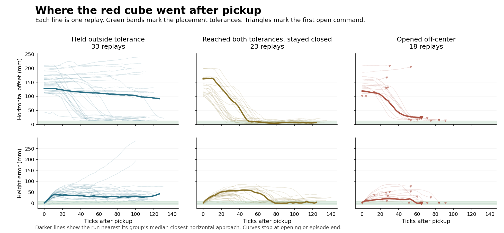

# Can RGB noise steering fix the carry to the target?

The most common failure that reproduced was a lifted cube that never reached horizontal alignment and a gripper that never opened. DSRL trained on a visual alignment reward produced **114 stable stacks in 320 fresh trials (35.6%)**, compared with **118/320 (36.9%)** for the frozen RGB flow policy and **124/320 (38.8%)** for the previous progress-reward actor. The fresh test did not establish a stacking gain or a reduction in the targeted failure.

| Controller | Stable stacks | Success | Never centered and never opened | Lifted |
| --- | ---: | ---: | ---: | ---: |
| Frozen RGB flow policy | 118/320 | 36.9% | 48/320 | 273/320 |
| Previous DSRL, visual progress reward | 124/320 | 38.8% | 52/320 | 279/320 |
| Targeted DSRL, visual progress and carry alignment | 114/320 | 35.6% | 43/320 | 269/320 |

Compared with the frozen base, targeted steering gained 26 stacks and lost 30 on matched trials. The difference was **−1.25 percentage points** (paired 95% scene-bootstrap interval **−6.25 to +3.44**). Compared with previous steering, it gained 21 stacks and lost 31, a **−3.13-point** difference (95% interval **−8.13 to +1.56**). Resampling lighting groups and actor seeds together gave intervals of −8.8 to +6.9 points against the base and −9.6 to +4.2 against previous steering.

## What happened after pickup

The earlier experiment preserved outcomes, resets, first camera frames and noise seeds. It did not record the original per-tick trajectories. We replayed all 256 unsteered scene/noise pairs and selected the 127 originally labeled “lifted, failed” across 81 distinct scenes. Of those 127, 103 again lifted and failed, 19 stacked and 5 did not lift. In the original records, 109 of 127 still registered a grasp on at least one of the final eight ticks. The breakdown below describes the 103 reproduced failures. [Original cohort with replay events](original-127.csv) · [Diagnosis totals](diagnosis.json)

| First carry and release behavior | Runs | Measured geometry or timing |
| --- | ---: | --- |
| Never centered, never opened | 33 | Median closest horizontal approach was 91.3 mm |
| Reached both placement tolerances, never opened | 23 | 21 stayed inside both bands for at least eight consecutive ticks while grasped. Median longest stay was 27 ticks |
| Centered, missed the height tolerance, never opened | 17 | Median closest signed height error while centered was +42.3 mm |
| Opened off-center | 18 | Median offset at opening was 22.9 mm. Ten also opened above the height band |
| Opened centered but high | 3 | Median height at opening was 20.2 mm above the stack position |
| Opened within both bands, then failed the terminal stack score | 9 | Median offset at opening was 5.4 mm |

Horizontal alignment requires less than 12 mm between cube centers in XY. The vertical band is ±8 mm around a 46.8 mm center-to-center height difference. Lift starts when Isaac detects a grasp and the red cube is above 65 mm. We measured geometry immediately before the first open command after lift. Commanded opening and loss of physical grasp were logged separately.

Of the 103, **73 never commanded opening after pickup**. The 18 off-center releases opened a median of 53 ticks after lift. The 83 successful replays across the full reset bank opened a median of 68 ticks after lift and 6.5 mm off-center. All 83 opened within the horizontal band, including 25 that opened above the height band and still stacked. These observations distinguish failure to transport, failure to descend and failure to open even after reaching position.



## How the alignment reward was trained

The new DSRL reward targets the largest individual failure group, the 33 uncentered carries with no open command. A small network reads the frozen 16-dimensional camera features and estimates the remaining expert XYZ commands until the demonstrated release, along with whether the demonstrator is carrying. Its training set is 72 successful demonstrations with synchronized RGB and commands. Simulator positions and grasp flags were used to diagnose failures and score evaluations. The reward network learned from the demonstrations' command sequences. [Reward estimator](../../scripts/rgb_approach_probe.py)

The frozen RSSM imagines four successive three-action chunks. During predicted carrying, an extra reward favors horizontal commands in the estimated direction of release and reductions in estimated remaining XY travel. The existing visual progress reward stays active. Each of five seeds received 1,500 SAC updates and 576,000 imagined action ticks, using the same seed-specific initialization and posterior start pool as the previous actor. At deployment, the actor shifts the Gaussian input of the frozen flow policy using the camera-conditioned recurrent state. The diagnostic states and the reward estimator are absent from its control loop. [Targeted actor](../../scripts/rgb_failure_actor.py) · [Physical scorer](../../scripts/rgb_score.py)

On four held-out expert sequences, the estimator's mean horizontal direction cosine was 0.477. Its normalized mean absolute error beat median-command prediction on X (0.493 versus 0.636) and fell behind it on Y (0.206 versus 0.156). These outputs estimate remaining demonstrated commands in action units.  [Estimator validation](approach.json)

## Paired evaluation

The three controllers shared the same 160 new Isaac scenes, two Gaussian streams per scene, exact physical reset and initial camera pixels. Subsequent decisions used live table and wrist RGB. The ten lighting groups contained 16 scenes each. Each scene was assigned to one of five matched actor-seed pairs, giving each seed 32 scenes and 64 trials across both streams. The held-out scenes were used after training. A separate repeat of the unsteered base on the first stream measures rollout variability. Across the main comparison and the repeat there were 1,120 Isaac rollouts. [Evaluation protocol](protocol.json) · [All rollout outcomes](fresh-outcomes.csv)

A stack required the final eight ticks to have an open command, open fingers, aligned cube positions, the lower cube on the table and both cube speeds below 25 mm/s. The intervals below use paired resampling of physical scenes, keeping both noise streams together. The summary also reports a sensitivity check resampling lighting groups and actor seeds. [Paired statistics](summary.json)

## Did the targeted failure change?

Uncentered carries with no opening fell from 48 to 43 relative to the base, a difference of **−1.56 points** of all trials (paired 95% interval **−5.31 to +2.19**). Among those 48 base failures, the targeted actor stacked 7, repeated the same failure on 28, and had other failures on 13. Another 15 trials entered this failure category under targeted steering. Relative to the previous actor the incidence difference was −2.81 points (95% interval −6.88 to +1.25). All three controllers lifted and subsequently failed on exactly 155 trials apiece, with different scenes contributing. [Paired outcome records](fresh-outcomes.csv)

| Actor training seed assigned to scene | Frozen base stacks | Previous actor stacks | Targeted actor stacks |
| --- | ---: | ---: | ---: |
| 101 | 27/64 | 26/64 | 23/64 |
| 211 | 20/64 | 24/64 | 25/64 |
| 307 | 23/64 | 20/64 | 19/64 |
| 401 | 27/64 | 30/64 | 28/64 |
| 503 | 21/64 | 24/64 | 19/64 |

The targeted actor beat the base on two of five assigned scene subsets and the previous actor on one. With the same frozen base, first noise stream and resets, the original and repeat passes stacked on 57 and 58 of 160 trials and agreed on 135/160 individual outcomes. The largest native initial-image mean absolute difference was 3.15 intensity units on the 0–255 scale. Each arm used the identical stored reference pixels for its first action chunk. Per-scene rescues and regressions include this rollout variability.

A separate check measured the visual reward's direction 12 ticks after lift on fresh base trials that still held the cube outside horizontal tolerance. Over 269 eligible carries, the estimated direction had a positive projection onto the physical target direction on 91.1% of trials. Its mean cosine was 0.737, versus 0.016 after shuffling estimates across trials. It was less accurate within the eventual targeted failure group (mean cosine 0.486 on 46 eligible trials) than within successful stacks (0.842 on 118). This measures the reward estimate on live camera features. Its accuracy on imagined trajectories and how much the frozen flow can change its carry in response to a noise shift are still open questions. [Camera direction check](carry-audit.json)

## Reproduction and verification

Use the Isaac environment and frozen artifacts from the [original RGB experiment](../isaac-rgb-actions-v12/README.md). The runner expects the earlier recording corpus under `inputs/` and recorded resets under `test-paired/`. The previous run’s `rgb-actions.tar.zst` and `paired-records.tar.gz` supply them. Run the following from the repository root.

```bash
bash scripts/run_rgb_target.sh runs/isaac-rgb-target-v13 runs/isaac-rgb-actions-v12
python scripts/plot_rgb_failure_traces.py runs/isaac-rgb-target-v13
```

The local run stores the diagnosis traces, fresh traces and trained checkpoints in the following archives. Extract each under `runs/isaac-rgb-target-v13/` to inspect the saved records directly. We independently recomputed all 1,120 terminal outcomes from commands, jaw aperture, cube poses and speeds and verified identical initial camera features within each physical scene. All five actor checkpoints match the prior frozen flow, visual RSSM and posterior start-pool fingerprints.

| Artifact | SHA-256 |
| --- | --- |
| Frozen flow and RGB encoder, `flow.pt` | `8e69bc49405dafa2f2f74fd4ce99243aaed6b2d8d1bf0ed96ad71a1cac6f97c6` |
| Frozen visual RSSM and progress model, `world.pt` | `6d2fa02500b7e0b4487a3d410e2e69f8a98adc3f025802d285b423da535b25ce` |
| `diagnosis-records.tar.gz` | `a4b3e3987ad2b92e0e3ac897c128ce723ad2ba4e02aaf243a7c024fa09842b08` |
| `fresh-records.tar.gz` | `af30dc54bb93326348e42787589a2333723ebf26948b285b2a8b8d549390e80a` |
| `target-checkpoints.tar.gz` | `b3149a583f47f26cd82060b6eaaf0c6e2a22baf08ba9d494b2780af4b2453b1d` |
