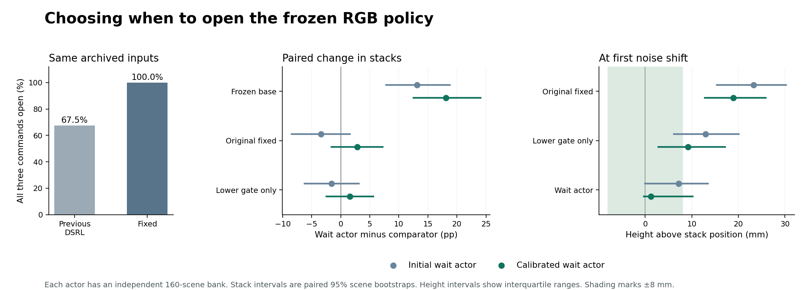

# Learning when to release a cube with a frozen RGB policy

**A noise-space actor trained in the calibrated visual RSSM raised stable stacking from 97/320 (30.3%) to 155/320 (48.4%) on fresh Isaac scenes.** The gain was **18.1 percentage points** (paired 95% scene interval +12.5 to +24.1). All five seed-assigned scene subsets improved, by 14.1 to 21.9 points. The original fixed shift stacked 146/320 (45.6%). The actor’s nine-stack lead over fixed was +2.8 points (−1.6 to +7.2). A fixed shift using the same lower visual trigger stacked 150/320. The additional effect of the learned wait decision was +1.6 points (−2.5 to +5.6). [Confirmation scores](calibrated/summary.json) · [Paired confirmation outcomes](calibrated/test-outcomes.csv)

The earlier state-input experiment gained 18.9 points, from 59.8% to 78.7%. The calibrated RGB actor reached a similar gain over its own baseline. Its absolute stack rate was 30.3 points below the earlier actor. The policies, scene banks and seed designs differ. The state-input experiment crossed every actor seed with every scene, while this RGB study assigned one of five seeds to each scene and evaluated two noise streams. [State-input experiment](../isaac-release-margin-v11/README.md)

## Independent confirmation of the calibrated actor

| Controller | Stable stacks | Shifted | Median height at first shift | Median XY error at first shift |
|---|---:|---:|---:|---:|
| Frozen RGB base | 97/320 (30.3%) | 0 | — | — |
| Original fixed shift | 146/320 (45.6%) | 208 | 18.9 mm | 7.8 mm |
| Previous continuous DSRL | 145/320 (45.3%) | 208 | 18.9 mm | 8.3 mm |
| Lower visual gate + fixed shift | 150/320 (46.9%) | 196 | 9.1 mm | 7.4 mm |
| RSSM wait actor | 155/320 (48.4%) | 170 | 1.2 mm | 7.8 mm |

| Matched difference | Gain (pp) | Paired 95% scene interval | Lighting and seed sensitivity interval | Wins / losses |
|---|---:|---:|---:|---:|
| Wait actor − frozen base | +18.1 | +12.5 to +24.1 | +10.3 to +26.1 | 67 / 9 |
| Wait actor − original fixed | +2.8 | −1.6 to +7.2 | −3.1 to +7.7 | 26 / 17 |
| Wait actor − lower gate only | +1.6 | −2.5 to +5.6 | −5.3 to +9.6 | 23 / 18 |
| Wait actor − previous DSRL | +3.1 | −0.6 to +6.9 | −3.8 to +12.3 | 23 / 13 |
| Original fixed − frozen base | +15.3 | +8.8 to +22.2 | +6.4 to +24.8 | 67 / 18 |

| Actor seed | Base | Fixed | Lower gate only | Wait actor | Wait − base (pp) | Wait − fixed (pp) |
|---:|---:|---:|---:|---:|---:|---:|
| 101 | 14/64 | 24/64 | 25/64 | 28/64 | +21.9 | +6.3 |
| 211 | 27/64 | 36/64 | 37/64 | 38/64 | +17.2 | +3.1 |
| 307 | 20/64 | 26/64 | 24/64 | 29/64 | +14.1 | +4.7 |
| 401 | 18/64 | 28/64 | 31/64 | 28/64 | +15.6 | 0.0 |
| 503 | 18/64 | 32/64 | 33/64 | 32/64 | +21.9 | 0.0 |

On the recorded unsteered paths, 223 trials failed. The original fixed trigger could intervene on 109 of those failures with eight ticks left. The lower visual gate could intervene on 102, and the learned waiting decision admitted 90. These are reachable episodes along the measured base paths. They give no guarantee that an intervention would convert the episode to a stack. The base repeat agreed on success or failure in 137/160 paired replays (48 versus 47 stacks).

**Where the nine additional stacks came from.** The calibrated actor and fixed shift each rescued 67 of the base’s 223 failures. The actor retained 88 of the base’s 97 successes, compared with 79 for fixed. They both stacked on 36 of the 55 matched trials where the base reached position and never opened. The nine-stack net lead therefore came from preserving more base successes in these paired records. The individual trajectories include renderer and physics replay variation. [Matched diagnostics](calibrated/matched-diagnostics.json)

At first intervention the calibrated actor was 1.2 mm above stacking height at the median, versus 18.9 mm for fixed, with essentially the same lateral error (7.8 mm for each). It issued an open command within six ticks on all 170 trials it shifted. In 85/170 it shifted inside both placement tolerances, versus 9/208 for fixed. In the 153 pairs where both controllers shifted, the actor intervened a median of six ticks later and 13.3 mm lower. The aggregate medians describe different sets of interventions. [Placement and action records](calibrated/test-outcomes.csv)

When the base reached the full placement band and never opened, the wait actor stacked 36/55 paired trials, fixed stacked 36/55 and previous DSRL stacked 33/55. When the base centered without reaching stacking height and never opened, those counts were 4/19, 6/19 and 3/19. In 8 of the 17 fixed-only stacks, only fixed applied a shift. These are matched trajectory observations and can include replay variation.

The six-tick descent audit used 132 unsteered opportunities with a visible cube and a continuously closed gripper. The raw RSSM predicted a median height change of -2.00 image-space units, versus -0.70 measured. The raw, training-scale-adjusted and stationary forecast mean absolute errors were 1.41, 0.29, 0.70, respectively. [Coverage](calibrated/test-coverage.json) · [Forecast measurements](calibrated/test-dynamics.json)

## First fresh test with the original RSSM forecast

| Controller | Stable stacks | Shifted | Median height at first shift | Median XY error at first shift |
|---|---:|---:|---:|---:|
| Frozen RGB base | 100/320 (31.3%) | 0 | — | — |
| Original fixed shift | 153/320 (47.8%) | 212 | 23.3 mm | 8.3 mm |
| Previous continuous DSRL | 161/320 (50.3%) | 213 | 23.4 mm | 7.7 mm |
| Lower visual gate + fixed shift | 147/320 (45.9%) | 183 | 13.0 mm | 7.5 mm |
| RSSM wait actor | 142/320 (44.4%) | 104 | 7.2 mm | 6.4 mm |

| Matched difference | Gain (pp) | Paired 95% scene interval | Lighting and seed sensitivity interval | Wins / losses |
|---|---:|---:|---:|---:|
| Wait actor − frozen base | +13.1 | +7.8 to +18.8 | +4.7 to +21.8 | 54 / 12 |
| Wait actor − original fixed | −3.4 | −8.4 to +1.6 | −12.7 to +5.3 | 25 / 36 |
| Wait actor − lower gate only | −1.6 | −6.3 to +3.1 | −9.7 to +6.4 | 29 / 34 |
| Wait actor − previous DSRL | −5.9 | −10.9 to −0.9 | −15.8 to +3.1 | 21 / 40 |
| Original fixed − frozen base | +16.6 | +10.3 to +23.1 | +8.3 to +26.1 | 66 / 13 |

| Actor seed | Base | Fixed | Lower gate only | Wait actor | Wait − base (pp) | Wait − fixed (pp) |
|---:|---:|---:|---:|---:|---:|---:|
| 101 | 16/64 | 25/64 | 30/64 | 28/64 | +18.8 | +4.7 |
| 211 | 17/64 | 28/64 | 25/64 | 20/64 | +4.7 | −12.5 |
| 307 | 22/64 | 32/64 | 26/64 | 29/64 | +10.9 | −4.7 |
| 401 | 20/64 | 34/64 | 34/64 | 32/64 | +18.8 | −3.1 |
| 503 | 25/64 | 34/64 | 32/64 | 33/64 | +12.5 | −1.6 |

On the recorded unsteered paths, 220 trials failed. The original fixed trigger could intervene on 108 of those failures with eight ticks left. The lower visual gate could intervene on 97, and the learned waiting decision admitted 62. These are reachable episodes along the measured base paths. They give no guarantee that an intervention would convert the episode to a stack. The base repeat agreed on success or failure in 139/160 paired replays (51 versus 46 stacks).

The initial wait actor improved on the base in all five seed subsets but scored eleven fewer stacks than fixed. It intervened in 104 trials versus 212 for fixed. When the base reached the full placement band and never opened, the wait actor stacked 30/50 paired trials, fixed stacked 34/50 and previous DSRL stacked 41/50. When the base centered without reaching stacking height and never opened, those counts were 3/22, 11/22 and 14/22. In 30 of the 36 fixed-only stacks, only fixed applied a shift. These are matched trajectory observations and can include replay variation.

The six-tick descent audit used 145 unsteered opportunities with a visible cube and a continuously closed gripper. The raw RSSM predicted a median height change of -1.80 image-space units, versus -0.68 measured. The raw, training-scale-adjusted and stationary forecast mean absolute errors were 1.24, 1.24, 0.69, respectively. [Matched diagnostics](matched-diagnostics.json) · [Coverage](test-coverage.json) · [Forecasts](test-dynamics.json) · [Per-trial outcomes](test-outcomes.csv)

## Does fixed noise reliably beat the previous continuous DSRL actor?

The two fresh banks independently reran the same frozen base, original fixed shift and previous DSRL weights. Across their 640 paired scene/stream trials, the base stacked 197 times, fixed stacked 299 times and previous DSRL stacked 306 times. Previous DSRL’s gain over base was +17.0 points (+12.8 to +21.4). Fixed gained +15.9 points (+11.4 to +20.6). The previous DSRL actor’s advantage over fixed was +1.1 points (−2.2 to +4.5). The earlier fixed advantage was specific to its observed cohort. A repeatable difference in producing open commands coexists with uncertainty about the overall stack ranking. These descriptive pooled intervals resample physical scenes within each bank and retain both streams. The different wait actors each have their own independent estimate above. [Same-controller pooled comparisons](pooled-controls.json) · [Paired analysis code](../../scripts/audit_rgb_wait_pairs.py)

## Why fixed noise scored higher in the previous RGB experiment

The fixed shift scored 137/320 versus 127/320 for the previous continuous DSRL actor. It won 34 matched trials and lost 24. The difference for fixed minus DSRL was +3.1 percentage points (paired 95% scene interval −1.6 to +7.8). The physical replays alone leave uncertainty about the ten-stack difference. In 34 of the 58 discordant pairs, only one controller applied a shift. Live renderer and physics differences can move paired runs onto different paths before steering.

We reconstructed both proposals on **the same first-intervention inputs** from both sets of trajectories. Each replay shared the camera features, recurrent history, frozen flow weights and Gaussian draw across proposals. The archived float16 features reconstructed the recorded commands to mean absolute error 0.00011. Fixed −14 produced three open commands on 372/372 inputs. The previous learned proposal did so on 251/372 (67.5%). On the remaining 121 its median proposed shift was −3.96, versus −17.86 on the 251 it opened fully. The median live-camera readiness score in the incomplete group was 0.55. The feature-based readout used for the imagination reward gave 0.28. In the fully open group those medians were 0.64 and 0.73. That mismatch is a plausible contributor to weak learned proposals on some live inputs. These counterfactuals establish what the frozen flow would command. The physical outcome under the alternative command remains unknown. [Paired historical trials](historical-pairs.csv) · [Same-input counterfactuals](same-observation.csv) · [Full audit](historical-gap.json)

The original fixed and learned controllers first intervened at median heights of +25.3 and +25.8 mm, and median horizontal offsets of 8.4 and 8.7 mm. Fixed noise produced an open command within six ticks on all 193 runs where it intervened; the previous actor did so on 156/179. Fixed also perturbed XYZ commands more on the same inputs (mean absolute change 0.093 versus 0.076 on the normalized command scale).

## How the new actor learned when to release

The frozen flow policy learned from the table and wrist RGB and commands in 72 successful demonstrations. Its visual RSSM learned from 24 demonstrations and 72 varied rollouts. The two cameras supply four relative red/blue image-center coordinates. The successful demonstrations define their center and covariance at release. We estimated the direction of descent in these normalized coordinates using 72 pairs of frames, comparing the expert open command with 14 ticks earlier. The component along that direction measures apparent height. The remaining distance measures lateral mismatch in the two views. These are image-space quantities. Isaac millimeters appear only in the evaluation and development diagnostics. The visual pipeline assumes the known red and blue cube colors and camera arrangement. [Geometry estimator](../../scripts/rgb_wait_geometry.py) · [Validation](placement-view.json)

A readout learned the four image residuals from the frozen encoder’s features, using the 72 demonstrations and 72 varied RGB recordings. Each imagined trajectory starts at a recorded posterior state with an observed two-view offset. Subsequent offsets follow the changes predicted by the frozen RSSM and readout. The start pool contained 1,818 observations during sustained closed-gripper approaches. On the four reserved expert sequences the signed height cue was 4.1–5.8 normalized units fourteen ticks before release and −0.32 to +0.72 at release.

Each actor decides whether to keep the nominal Gaussian draw for this chunk or propose −14 on its gripper coordinate. Both branches share the same draw. The release branch tries 65%, 82% and 100% of the proposal through the frozen flow, as in the original fixed controller. Opening earns higher return with low height error and low lateral error. The return includes a penalty for disturbing Cartesian commands and a cost for waiting. An opening from the base during a wait also earns its geometry-dependent return. We compute finite-horizon stopping values backward along eight three-action chunks and train a network to predict the advantage of steering now over waiting. Each of five seeds used 1,290,240 imagined action ticks. This discrete noise-space actor changes the timing of a reliable shift. The base flow, camera encoder, prior progress head and visual RSSM retain their earlier weights. [Training objective](../../scripts/rgb_wait_actor.py) · [Deployment logic](../../scripts/rgb_wait_control.py)

Three visual operating windows were evaluated on 64 development scenes. To qualify, a candidate’s median first intervention had to be at least 4 mm lower than the original fixed shift and less than 12 mm off-center. All three qualified. Selection by stable stacks chose the middle window (27/64), ahead of the tight (25/64) and wide (24/64) settings. The original fixed shift reached 31/64 and the unsteered base 21/64. The middle window requires signed height between −2.15 and +1.85 and lateral residual ≤2.05, two successive eligible observations after twelve closed ticks, and predicted release advantage ≥−0.045. Once chosen, the release pulse can last sixteen three-tick decisions. [Development selection](selection.json)

The fresh comparison used 160 previously unused physical scenes in ten lighting groups and two Gaussian streams each. Both previous controllers were rerun. A matched control used the selected lower visual window and fixed release shift without the learned wait decision. Every scene has all five arms and both streams, with 32 scenes per assigned actor seed, and an unsteered repeat on stream one. This yields 1,760 fresh Isaac trials. The primary score requires eight consecutive final ticks with open fingers, an open command, stable cubes and placement inside the 12 mm horizontal and ±8 mm height bands. Confidence intervals resample physical scenes with their two streams together. A separate sensitivity analysis resamples lighting groups and actor seeds. [Fresh protocol](protocol.json) · [Outcome records](test-outcomes.csv)

## Correcting the RSSM’s forecast of descent

On the first development bank, the visual RSSM expected the cube to descend farther than the camera subsequently observed near the release window. At the earliest eligible opportunity on each unsteered trajectory, we replayed the actual next commands in imagination and measured the change in apparent height against the next real RGB frames. The three-tick median was −0.79 predicted and −0.33 observed. Its mean absolute error was 0.82 image-space units. Predicting no change gave 0.44. This makes continued waiting look more attractive in the imagined return. [Development forecast audit](dev-dynamics.json)

Using 21 six-tick development examples where the gripper remained closed and the cube remained visible, we fit one multiplier (0.261) to the RSSM’s predicted change in vertical image position. Each imagined branch starts from the measured image position and applies this multiplier to subsequent vertical changes. We kept the lateral forecast, lower visual window, action choices and deployment logic fixed. We then retrained all five wait actors. This uses development RGB and executed commands to calibrate an imagined forecast. All counterfactual action selection and actor learning occurred inside the frozen visual RSSM. [Calibration fit](calibrated/dev-height-calibration.json) · [Forecast audit code](../../scripts/audit_rgb_wait_dynamics.py)

We screened the calibrated actor on a separate bank of 64 development scenes. It stacked 33/64 versus 31/64 for fixed and 19/64 for the base. On trials with an intervention, its first shift was 7.4 mm above placement at the median with 6.8 mm horizontal error. Fixed shifted at 20.7 mm with 7.8 mm horizontal error. This met the predeclared rule for a fresh test. The confirmation used another 160 unseen scenes with the same protocol and controls. The two fresh banks have different scenes, so differences between their results cannot isolate the causal effect of calibration. [Development results](calibrated/selection.json) · [Second test protocol](calibrated/protocol.json)

## Outcome verification and records

The two independent 160-scene banks contain 3,520 physical rollouts including controls and unsteered repeats. We rederived every final stack decision from the recorded actions, jaw aperture, cube positions and speeds. Initial camera encodings agreed within each matched scene, and the recorded intervention decisions matched the visual gates, learned thresholds and pulse rules. Replaying the frozen flow with the saved camera encodings and Gaussian draws reproduced each of the 704,000 gripper-command signs. Mean absolute action error was 0.000066 on both banks from the compressed features. The first and second banks respectively used scene IDs 1110000–1110159 and 1310000–1310159. All 512 development rollouts used separate scenes. [First-bank archive](https://github.com/ryanrahman27/MiniDayDreamer/releases/download/rgb-stacking-v1/rgb-first-bank-traces.tar.gz) · [Confirmation archive](https://github.com/ryanrahman27/MiniDayDreamer/releases/download/rgb-stacking-v1/rgb-confirmation-traces.tar.gz)

## Reproduction

The [reproduction guide](../../docs/rgb-stacking.md) covers CPU scoring from the released trajectories, Isaac replay with the archived resets, and training from the RGB/action recordings.

The calibrated runner promotes its actor to the separate confirmation bank only if it wins more stable stacks than the original fixed controller on the second development bank, intervenes at least 4 mm lower at the median and has median horizontal error below 12 mm. Both development and fresh archives preserve the corresponding reset banks, reference images, camera embeddings, actions, measured trajectories, visual release scores, actor advantages, trigger decisions and effective noise shifts. The physical measurements are diagnostic and scoring data. [Main runner](../../scripts/run_rgb_wait.sh) · [Calibration runner](../../scripts/run_rgb_wait_calibrated.sh)

The SHA-256 fingerprints of the frozen flow including the RGB encoder and the visual RSSM including its progress estimator are `8e69bc49405dafa2f2f74fd4ce99243aaed6b2d8d1bf0ed96ad71a1cac6f97c6` and `6d2fa02500b7e0b4487a3d410e2e69f8a98adc3f025802d285b423da535b25ce`. Each checkpoint records its seed, geometry and posterior-state fingerprints. The main and calibrated actors share those fingerprints.

The fresh record archive SHA-256 digests are `888449ef0a0403e160f15e39be8ffcac9224a8656d80556cd643fce379bacbe6` (first) and `e149e1787a5a6e829c5292f1258bcc3942ef13e206b2fc3c63c7231b0bc9a317` (confirmation). [First-bank checkpoints](https://github.com/ryanrahman27/MiniDayDreamer/releases/download/rgb-stacking-v1/rgb-first-bank-weights.tar.gz) · [Calibrated checkpoints](https://github.com/ryanrahman27/MiniDayDreamer/releases/download/rgb-stacking-v1/rgb-calibrated-actors.tar.gz)
