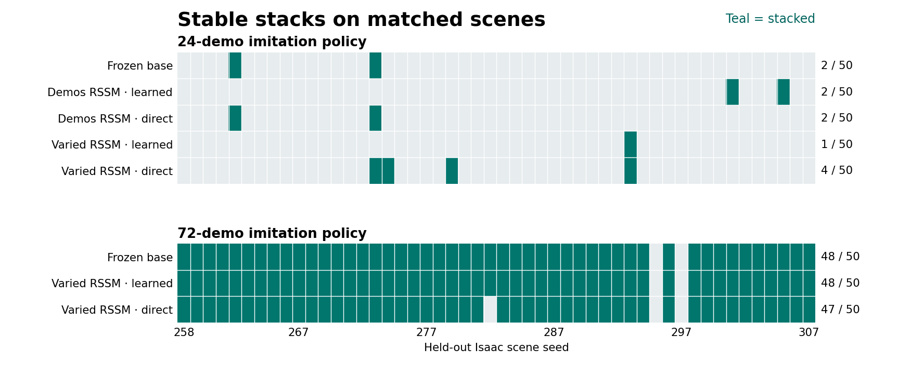

# Computing the stacking reward from predicted states

Direct reward improved return prediction and produced a small stacking gain with the original base and varied-data world model. Across 50 fresh Isaac scenes, this actor stacked four times. The learned-reward actor stacked once and the original imitation policy stacked twice. The largest improvement came from imitation itself. A separate 72-demo policy stacked on 48 of the same 50 scenes before steering.

| Frozen imitation policy | RSSM used for steering | Unsteered stacks | Learned-reward stacks | Direct-reward stacks | Direct vs. learned, gained / lost |
| --- | --- | ---: | ---: | ---: | ---: |
| Original, 24 demos | Demos only | 2/50 | 2/50 | 2/50 | 2 / 2 |
| Original, 24 demos | Varied rollouts | 2/50 | 1/50 | 4/50 | 3 / 0 |
| Relative-geometry policy, 72 demos | Varied rollouts | 48/50 | 48/50 | 47/50 | 0 / 1 |

The original base in the first two rows is the same checkpoint evaluated once per scene. With varied rollouts, direct steering retained the learned actor's one success and added three (+6 percentage points, paired exact p = 0.25). Against unsteered imitation it gained three scenes and lost one (+4 points, p = 0.625). With demos alone the two actors succeeded on entirely different pairs of scenes. The counts give a direction worth distinguishing from the clear improvement in reward accuracy. Fifty scenes and one training seed leave substantial uncertainty about a repeatable RL gain. [Per-scene outcomes](paired-outcomes.csv) · [Full paired statistics](reward-summary.json)

The 72-demo policy stacked on 11/12 development scenes at 12,000 updates. On the 50 fresh scenes it retained both original-base successes and added 46. Learned-reward steering reproduced all 48 of its successes. Direct steering lost seed 282 and both steering actors still failed on seeds 295 and 297. This stronger baseline left two opportunities to improve the stack count. The experiment leaves the effect of steering a moderately competent base open. [Development trials](calibration.json)



### How much steering changed the action

We replayed each unsteered trajectory with the same observations and Gaussian draws, reproduced its recorded first command at each three-tick chunk boundary, and then applied each varied-RSSM actor's noise shift. We projected the first Cartesian command toward the target on lifted, closed-gripper carries outside the 12 mm horizontal tolerance. These are changes in requested displacement. Isaac rollouts determined their effect on success.

On the original base, the direct actor changed the target-directed command by a median absolute **0.13 mm** over 1,387 carrying chunk starts outside tolerance. Its signed mean change was +0.11 mm, compared with −0.15 mm for learned reward. Each steering actor flipped the first gripper decision only once across all 1,491 carrying chunk starts. On the stronger base, the median absolute target-directed change was **0.04 mm** for direct reward and **0.02 mm** for learned reward. Neither actor flipped a first gripper decision across 1,115 carrying chunk starts. These small changes and the stronger policy's high starting success help explain how a large reduction in reward error can coexist with similar task performance. [Action replay measurements](reward-summary.json)

## What the noise actor optimized

For each imagined control tick, the direct reward was the change in task potential plus a one-time stable-stack bonus.

```text
r(t) = Φ(state[t+1]) − Φ(state[t]) + 2 × first_stable_stack[t+1]
```

The potential is the same weighted sum of wrist proximity, grasp, cube height and cube-to-target proximity used when generating Isaac rewards. We evaluated it on consecutive RSSM-decoded states. For the terminal event, the red cube had to be within 12 mm horizontally and 8 mm vertically of its stacked position, blue had to be at table height, the gripper had to be open and clear by 50 mm, and both cubes had to stay slow for eight ticks. The 11-dimensional state supplies gripper command and grasp status. We used these in place of measured jaw aperture, and consecutive cube positions in place of instantaneous rigid-body velocities. Isaac's original success detector scored every evaluation episode.

The starting demonstration history supplies the consecutive stable-tick count at each imagination start. Each predicted sequence can pay the bonus once. The same learned success head controlled continuation in both reward arms through the per-tick discount `0.99 × (1 − predicted success probability)`. Only the learned-reward arm called the RSSM reward head.

### Reward accuracy

On measured states from 120 corpus trajectories, 24 independent diagnostic trajectories and 300 archived policy trials, the direct rule recovered all 77 Isaac stacks at the correct tick with zero false positives. The largest dense-reward discrepancy in the two datasets with recorded per-tick rewards was 0.00000021.

Starting from observed histories on the independent diagnostic set, we rolled each frozen RSSM forward with recorded actions and its deterministic prior. The table gives mean absolute error in discounted window return. Both six-tick models identified all 12 terminal windows with zero false positives under the direct reward. The 24-tick forecasts are a diagnostic. Steering in this study used six ticks. [Reward audit](reward-audit.json)

| RSSM and forecast horizon | Windows | Learned reward MAE | Direct reward MAE |
| --- | ---: | ---: | ---: |
| Demos only, 6 ticks | 729 | 1.916 | 0.035 |
| Varied rollouts, 6 ticks | 729 | 0.106 | 0.008 |
| Demos only, 24 ticks | 657 | 7.501 | 0.098 |
| Varied rollouts, 24 ticks | 657 | 0.254 | 0.037 |

On the 400 fresh evaluation traces, the direct rule applied to measured states matched all 154 completed stacks at their exact terminal tick, with zero false positives. On six-tick forecasts driven by actual unsteered actions, the varied RSSM's learned vs. direct return MAE was 0.061 vs. 0.014 for the original base and 0.111 vs. 0.004 for the 72-demo base. [Fresh trajectory checks](reward-summary.json)

Only 144 of the 3,764 possible demonstration-history starts had already accumulated the two or more stable ticks needed to finish an eight-tick stack in six imagined ticks. The direct actors received 3,341 bonuses in the demos-only RSSM and 3,727 in the varied RSSM for each base, over 576,000 predicted ticks per actor. From an actively carrying start, six ticks can provide dense progress reward and a bootstrapped value, but cannot span a new eight-tick stable release.

## Controls and scene splits

The primary comparison used the original 24-demo, 12,000-update imitation checkpoint. Each actor used one of two frozen residual RSSMs fitted in the previous experiment. The demos-only model saw 24 successful demonstrations. The varied model saw those demonstrations and 72 mixed-outcome rollouts. For each RSSM we restored the same pre-actor random state, trained each noise actor for 1,500 SAC updates, and generated 576,000 imagined control ticks in three-tick chunks. Each rollout began at a recorded history from one of the original 24 demonstrations and ran for six ticks. The original two learned-reward actors reproduced exactly, and we compared every evaluation checkpoint's base and world-model tensors to their frozen sources.

To test whether base competence limited steering, we collected 48 more successful Isaac demonstrations on seeds 2000–2047 for imitation only. A second flow policy used all 72 demos, relative wrist/cube/target inputs, a wider three-layer network, and matched horizontal flips and axis swaps for states and actions. We trained candidates at 12,000 and 30,000 updates. On separate development seeds 5200–5211, we chose the first candidate to stack on at least four of 12 scenes, or the higher-scoring candidate if neither cleared four. We froze this checkpoint and trained learned- and direct-reward actors in the existing varied RSSM. This comparison tests the combined imitation changes.

The eight policies faced the same 50 new scene seeds (258–307) with a common per-scene Gaussian noise stream, rotating arm order within each base group and verified initial states within 1 mm. Only seed 258 used cameras. All policies consumed simulator state. Each actor had one training seed. Paired gains and losses count the scenes on which exactly one of two policies stacked. The reported p-values use the two-sided exact McNemar test.

## Reproduction

Use the repository's Isaac environment and the frozen artifacts from the preceding two experiments. The original run scored seed 258 with cameras and scored the remaining two shards concurrently. For a new end-to-end training run on an Isaac corpus, the standard `python -m minidaydreamer train` command also accepts `--reward-mode direct`.

```bash
short=runs/isaac-residual-24-v2
archived=runs/isaac-horizon-24ticks-v3
run=runs/isaac-state-reward-v4
mkdir -p "$run"
cp "$short/base.pt" "$short/corpus.npz" "$run/"
python -m minidaydreamer collect --seed 2000 --demos 48 --extra 0 --holdout 1 --out "$run/extra-bc.npz"
python scripts/reward_study.py bc "$run"
python scripts/reward_study.py calibrate "$run"
for group in weak strong; do
  python scripts/reward_study.py actors "$run" --group "$group" --short "$short" --rng "$archived"
  python scripts/reward_study.py score "$run" --group "$group" --first 258 --count 1 --video
  python scripts/reward_study.py score "$run" --group "$group" --first 259 --count 24
  python scripts/reward_study.py score "$run" --group "$group" --first 283 --count 25
done
python scripts/check_state_reward.py "$run" --short "$short" --archived "$archived"
python scripts/summarize_reward.py "$run" --short "$short" --archived "$archived"
python scripts/plot_state_reward.py "$run"
```
