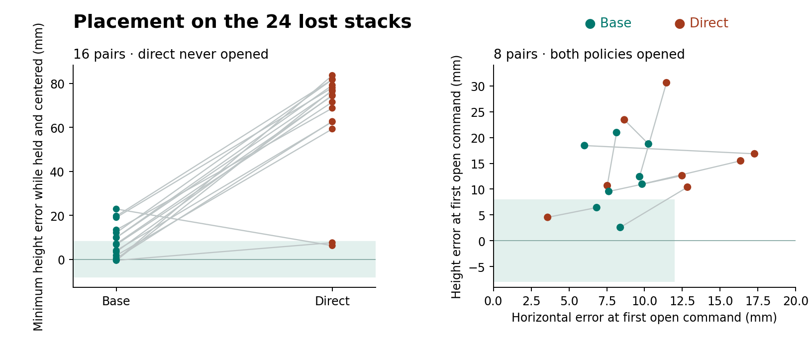

# Switching off noise steering over the stacking target

The most frequent failure on the 24 archived lost stacks was carrying the cube too high and keeping the gripper closed. On 100 new paired Isaac scenes, switching direct-reward steering off over the target produced **40 stable stacks**, versus **36 with always-on steering** and **51 with the unsteered base**. The handoff gained five scenes and lost one against always-on steering (+4 percentage points, two-sided exact McNemar p = 0.219).

| Policy | Stable stacks | Lifted | Reached handoff geometry | Never opened after lift |
| --- | ---: | ---: | ---: | ---: |
| Frozen imitation policy | 51/100 | 100 | 95 | 31 |
| Always-on direct steering | 36/100 | 100 | 95 | 45 |
| Direct steering until over target | 40/100 | 100 | 96 | 43 |

Against the base, the handoff gained ten scenes and lost 21 (−11 points, p = 0.071). Always-on steering gained nine and lost 24 (−15 points, p = 0.014). These are unadjusted paired tests. On the **fresh** 24 scenes where the base stacked and always-on steering failed, the handoff recovered four. Direct steering never opened on 14 of these fresh losses, and in 13 of those 14 the centered, held cube stayed above the height band. [All fresh outcomes and placement events](paired-outcomes.csv) · [Paired comparisons](handoff-summary.json)

The handoff triggered on 96 scenes, including 58 switches partway through an action chunk. Of the 45 fresh scenes where always-on steering never opened, the handoff triggered on 44, opened the gripper on three, and stacked on two. The 4-point overall gain provides limited evidence for a repeatable improvement, and the switch left most of the missed descents unresolved.

## What happened on the 24 archived losses

We selected all 24 scenes from the preceding experiment where the frozen imitation policy stacked and always-on direct-reward steering failed. For each seed we compared the two recorded trajectories at the first horizontal alignment, first opening command, first measured jaw opening and first observed grasp loss. The geometry is measured between cube centers. Desired red-minus-blue height is 46.8 mm, with an 8 mm vertical and 12 mm horizontal tolerance. Each 20 Hz control command is issued from the observation at the same index. The subsequent observation is 50 ms later. [Per-scene events](archived-placement-events.csv) · [Archived summary](archived-placement-summary.json)

| Direct-steered failure | Scenes | What the paired measurements showed |
| --- | ---: | --- |
| Never commanded opening after lift | 16 | All 16 still registered a grasp at timeout. In 14 the cube stayed more than 8 mm high every time it was held and centered. The median of each run's minimum height error while held and centered was +74.5 mm, versus +6.9 mm in the same 16 successful base runs. |
| Commanded opening after lift | 8 | All eight had previously crossed over blue. At the first open command, seven cubes were high and four were off-center, with overlap. One met both tolerances. No cube was below the height band. |

The two policies moved in opposite vertical directions immediately after first alignment on those 16 never-opened pairs. Over the next 12 ticks (0.6 s), all 16 base runs lowered red, by a median 11.6 mm. In 14 direct runs red rose, with a median change of +9.1 mm over all 16. The median of the mean commanded vertical displacements over those windows was −4.4 mm per tick for base and +3.6 mm for direct. The cube ended a median 332 mm above stack height in the direct runs, still grasped.

Among the eight opening pairs, direct steering opened on the same episode tick as the base twice and later six times. Relative to each controller's own first alignment, it opened sooner in two and later in six, with a median paired delay of 12 ticks (0.60 s). Seven direct runs and six of the eight successful base runs commanded opening above the height band. Their median signed height errors at the command were +14.0 and +11.7 mm respectively. Simply observing a high cube on the command tick is weak evidence of a bad release.

In all eight direct runs the first measured finger opening above 35 mm and the first loss of the simulator grasp signal occurred one tick after the command. At that observation two cubes were still high and five were off-center. The median height error had fallen to +3.7 mm, versus +0.9 mm for the paired base runs. The grasp signal and jaw measurement identify a release event to control-tick precision.

Two direct failures ended with the cube inside both geometric tolerances. On seed 334, the gripper finished only 14 mm from red and never satisfied the 50 mm clearance requirement while open and aligned. On seed 377 the open, clear and aligned geometry first appeared at tick 194, with only seven qualifying observations through the 200-tick limit. Eight stable ticks were required. These 24 cases were chosen for their discordant outcomes, so the counts describe that loss set.



Each line joins the two runs on the same seed. The shaded regions show the vertical tolerance at left and both placement tolerances at right.

## Handoff and fresh evaluation

The base was the previous 72-demo imitation policy selected at 15/32 development stacks. We reused the exact direct-reward noise actor and varied-data residual RSSM from that run. We compared the unsteered base, always-on direct steering and a permanent handoff on 100 new Isaac scene seeds (408–507). Each policy received the same per-scene sequence of Gaussian draws. Execution order rotated within scene. Seed 408 used cameras. Isaac's original eight-tick stable-stack criterion scored all arms.

At every control tick the handoff checks the measured state. It triggers the first time red is grasped, lifted more than 20 mm above its initial height and within 12 mm of blue horizontally. From that tick through episode end, the frozen policy receives unshifted noise. A switch within a three-tick action chunk uses the unshifted version of that same chunk from the same starting observation and Gaussian draw. This preserves the policy's normal update timing and changes only its noise shift.

The audit reconstructs the base and shifted actions from each arm's actual recorded history, rechecks the first eligible tick and verifies every executed action. The primary paired comparisons include every scene. A separate check compares always-on and handoff trajectories before the switch. It requires the same trigger tick, identical grasp and gripper-command histories, and a maximum 2 mm positional difference through that observation. Stable stacks are scored by a single rollout per arm per seed using one frozen actor.

All three arms had identical recorded starting coordinates per scene. Independent command replay agreed with every executed command to within 0.000006 in normalized action units. Ninety pairs satisfied the pre-switch trajectory match. Within those pairs the handoff gained three stacks and lost one (p = 0.625). Differences in physics history can affect the other matched-seed comparisons. [Pre-switch trajectory checks](paired-prefixes.csv)

## Reproduction

```bash
prior=runs/isaac-midbase-v5
run=runs/isaac-target-handoff-v6
mkdir -p "$run"
cp "$prior/selected-base.pt" "$prior/mid-varied-direct.pt" "$run/"
python scripts/placement_events.py "$prior" "$run"
python scripts/target_handoff.py "$run" --prior "$prior" --first 408 --count 1 --video
for first in 409 442 475; do
  python scripts/target_handoff.py "$run" --prior "$prior" --first "$first" --count 33
done
python scripts/summarize_handoff.py "$run" --prior "$prior"
python scripts/plot_placement.py "$run"
```
